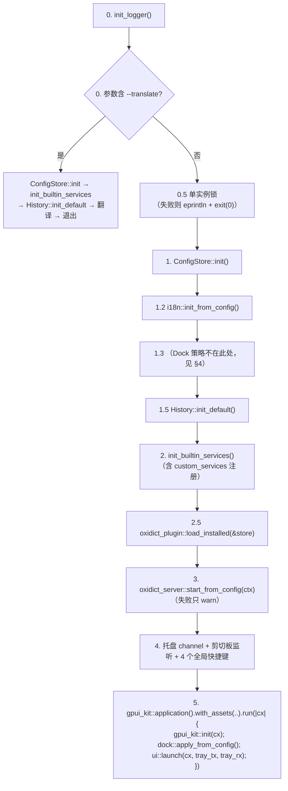
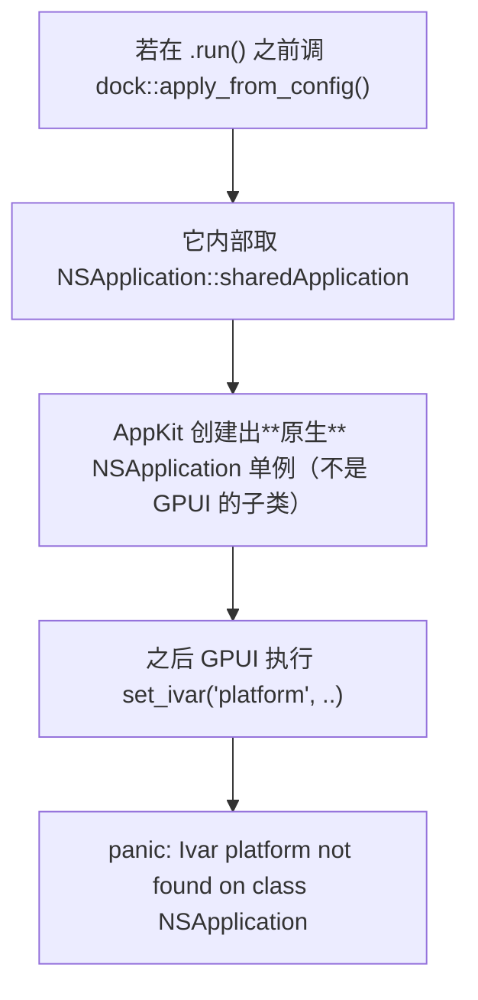
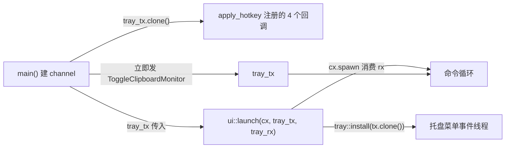

# app（二进制 `oxidict`）架构

> 面向维护者。使用者入口见 [README.md](./README.md)。整个包只有一个 294 行的 `src/main.rs`。

## 1. 定位

可执行入口与**唯一知道全部子系统的人**。它不做业务逻辑，只做三件事：

1. 按正确的**顺序**把各子系统拉起来（顺序本身有硬约束，见 §3）；
2. 提供进程级基础设施（日志、单实例锁、CLI 模式）；
3. 把注入点接好（本地 HTTP 服务的两个回调、托盘命令 channel、自定义资产源）。

它是唯一依赖全部 7 个 crate 的包，也是**唯一允许依赖 `oxidict-ui` 的包**。

| 依赖 | 用途 |
| --- | --- |
| `oxidict-core` | 配置、历史、i18n、runtime |
| `oxidict-services` | 注册内置服务、`translate_first_enabled_blocking` |
| `oxidict-platform` | 划词回调、Dock 策略 |
| `oxidict-plugin` | 加载已安装的 `.potext` |
| `oxidict-server` | 本地 HTTP 服务 |
| `oxidict-ui` | 窗口层与命令循环 |
| `gpui-kit` | 事件循环与资产源 |
| `fern` + `chrono` + `log` | 日志 |
| `libc` | **仅**用于单实例锁的 `kill(pid, 0)` 存活探测（Unix） |

## 2. 函数清单

| 函数 | 职责 |
| --- | --- |
| `main()` | 启动编排（§3） |
| `init_logger()` | `RUST_LOG` 过滤（缺省 `warn`），stdout + 文件双输出 |
| `run_cli_translate(text)` | `--translate` 模式：初始化最小子系统 → 翻译 → 打印 |
| `translate_once(req)` | **CLI 与 HTTP 共用的唯一翻译入口**：服务选择 + 按需写历史 |
| `acquire_instance_lock(path)` | 申请单实例锁 |
| `create_lock_file(path)` | 创建锁文件并在**同一句柄内**写入 PID |
| `lock_is_stale(path)` | 脏锁检测（带重试） |
| `process_alive(pid)` | `cfg(unix)`：`kill(pid, 0)`；`cfg(not(unix))`：保守返回 `true` |

## 3. 启动顺序（顺序本身是契约）



### 3.1 顺序上的硬约束

| 约束 | 原因 |
| --- | --- |
| CLI 分支必须在**单实例锁之前** | `--translate` 是命令行工具，不该因为 GUI 已开着就拒绝工作 |
| `ConfigStore::init` 必须在 `init_builtin_services` 之前 | 自定义服务注册要读 `custom_services`（`store_opt()` 为 `None` 时会跳过并 warn） |
| `i18n::init_from_config` 在 config 之后、UI 之前 | 窗口标题与托盘菜单文案在创建时取一次 |
| `dock::apply_from_config` **只能在 `.run()` 回调内** | 提前调用会让 AppKit 先创建原生 `NSApplication` 单例，随后 GPUI `set_ivar` panic（见 §4） |
| `history::init_default` 在翻译入口被调用之前 | `translate_once` 直接 `History::global()` |
| `plugin::load_installed` 在 `init_builtin_services` 之后 | 插件注册到同一张表；顺序决定同名时的覆盖关系 |
| 单实例锁在所有子系统之前 | 双开会争抢 `config.json` / `history.db` / 端口 |

### 3.2 三处「失败不阻断」

| 位置 | 失败处理 | 理由 |
| --- | --- | --- |
| 本地 HTTP 服务启动失败 | `log::warn!` 后继续 | 端口可能被正在跑的老版本 Tauri 应用占用，不该让新版本打不开 |
| 插件加载失败 | `load_installed` 内部只记日志，返回成功加载的 id 列表 | 一个坏插件不该让应用起不来 |
| 单实例锁**创建失败**（非「已存在」） | 记 warn 后返回 `true`（视作持锁成功） | 宁可放弃单实例保护，也不要让应用打不开 |

## 4. Dock 策略为什么被搬进 GPUI 回调

`main.rs` 的 1.3 位置原本是 Dock 初始化，现在只留一段注释说明为什么不在那儿：



正确做法：在 `.run(|cx| ...)` 回调内调用（此时 GPUI 已通过
`+[GPUIApplication sharedApplication]` 接管共享实例）。**改动启动顺序前先读这段注释**——
这是已经发生过一次的启动即崩事故。

## 5. 单实例锁

### 5.1 锁文件的两个细节

```rust
// 关键：create_new 与写入 PID 必须在同一个文件句柄内完成
let mut f = OpenOptions::new().write(true).create_new(true).open(path)?;
write!(f, "{}", std::process::id())?;
f.flush()?;
```

分两步（先 `create_new` 再单独 `fs::write`）会留出一个窗口：文件已存在但内容为空，
另一个刚开始启动的实例读不到有效 PID，会把它误判成**脏锁并删除**，于是两个实例同时运行。

`lock_is_stale` 因此也带重试：10 次 × 25ms。读不到有效 PID 时按崩溃残留的空文件处理。

### 5.2 平台差异

| 平台 | `process_alive` | 后果 |
| --- | --- | --- |
| Unix | `kill(pid, 0) == 0` | 脏锁可自动清理 |
| Windows | 恒 `true` | 崩溃残留的锁文件**不会被自动清理**，需用户手工删 `<runtime_dir>/oxidict-app.lock`。要做到对等需引入 `windows` crate 用 `OpenProcess` + `GetExitCodeProcess` 判定 `STILL_ACTIVE`（该依赖目前只在 `oxidict-platform` 里） |

已知误判：`EPERM`（进程存在但无权限探测）也会返回 -1，会被判为「进程已死」并清理锁。
沙箱/容器场景下表现为单实例保护偶发失效，**可接受**（`process_alive` 的文档注释里写明了）。

PID 超出 `i32` 范围时直接判定不存在，避免 `as` 截断成负数。

## 6. `translate_once`：唯一翻译入口

```
CLI (--translate) ─┐
                   ├─→ translate_once(req)
本地 HTTP 服务 ────┘
       └─ oxidict_services::translate_first_enabled_blocking(req)   ← 服务选择唯一实现
       └─ if !history_disable → History::global().add(...)
```

`main.rs` 里 `oxidict_server::ServerContext::new` 注入的翻译闭包就是
`translate_once(req).map(|(_instance, result)| result)`——**服务选择与历史写入全进程只有一份实现**。

`translate_first_enabled_blocking` 内部是 `block_on`，所以这个入口只能在**非 tokio 上下文**调用。
两个调用点（主线程 CLI、tiny_http 的独立线程）都满足。

## 7. 日志

```
RUST_LOG（缺省 warn）→ fern::Dispatch
  ├── format: "YYYY-MM-DD HH:MM:SS [LEVEL] message"
  ├── chain(std::io::stdout)
  └── chain(文件 <config_dir>/net.oxidict.app/logs/oxidict.log)
```

- 目录创建失败只 `eprintln`，不阻断启动。
- **文件打不开时降级为只输出 stdout**（`let dispatch = match file { Some(f) => .., None => .. }`）——
  日志不该成为启动的失败点。
- 托盘「查看日志」（仅 `dev_mode` 时出现在菜单）打开的就是这个目录。
- 默认级别是 `warn`，排查启动链路要 `RUST_LOG=info cargo run -p oxidict`——
  启动的每一步（配置目录 / 服务就绪 / HTTP 端口 / 插件加载）都是 `info` 级。

## 8. 托盘命令 channel 的接线



启动时的两条预置动作：

| 动作 | 条件 |
| --- | --- |
| 发 `ToggleClipboardMonitor` | `clipboard_monitor` 配置为 `true` |
| `apply_hotkey(name, keys)` × 4 | `hotkey_selection_translate` / `hotkey_input_translate` / `hotkey_ocr_recognize` / `hotkey_ocr_translate` 非空 |

**快捷键的生效链路只有 `oxidict_ui::hotkey::apply_hotkey` 一个入口**——启动时注册与设置里改键后热更新
走的是同一个函数，避免两套映射逻辑漂移。

## 9. 不变量与契约

| # | 不变量 | 违反后果 |
| --- | --- | --- |
| 1 | `--translate` 分支在单实例锁之前 | GUI 开着时 CLI 无法使用 |
| 2 | `ConfigStore::init` 先于 `init_builtin_services` | 自定义服务静默不注册（只 warn） |
| 3 | `dock::apply_from_config` 在 `.run()` 回调内 | **启动即 panic**（§4） |
| 4 | 锁文件创建与写 PID 在同一句柄 | 双开（两实例同时运行，争抢 config/db/端口） |
| 5 | 锁文件父目录必须先 `create_dir_all` | `create_new` 失败与「已有实例」表现一致 → 误退出。**这是已修过的 bug**（提交 `3ce41a5`） |
| 6 | 服务/插件/HTTP 启动失败不阻断主程序 | 一个子系统的环境问题让应用完全打不开 |
| 7 | 快捷键注册只有 `ui::hotkey::apply_hotkey` 一个入口 | 启动注册与热更新两套逻辑漂移 |
| 8 | 日志文件打不开时降级 stdout | 日志问题变成启动失败 |

## 10. 已知限制

- **Windows 上无脏锁检测**（§5.2），崩溃残留锁需手工删。
- **CLI 模式没有 `--help` / `--version`**，只认 `--translate <text>` 一种参数形态；
  参数不匹配就静默走 GUI 路径。
- **`expect("初始化配置失败")` 等直接 abort**：配置目录不可写、`history.db` 损坏时会 panic。
  这是「无法继续维持不变量」的场景，属刻意选择，但**用户看到的是崩溃而不是可操作的提示**。
- **插件加载在 `init_builtin_services` 之后但在窗口之前**：插件 VM 的创建是阻塞的，
  插件多时表现为启动变慢（`runtime::load` 是阻塞等待）。
- **无测试**：本包 0 个测试。可提取为纯函数的候选是 `lock_is_stale` 与 `create_lock_file`
  （两者都只依赖文件系统，容易覆盖），这是最值得补的点。

## 11. 扩展点

| 想加什么 | 改哪里 | 注意 |
| --- | --- | --- |
| 新 CLI 子命令 | `main()` 的参数分支 | 放在单实例锁**之前** |
| 新全局快捷键 | `config::keys` 加键 + 本文件 §8 的注册数组 + 设置页快捷键盘位 | 三处 |
| 新的启动期子系统 | 插进 §3 的链路 | 先确认它对「配置/历史/服务注册表」的前置依赖 |
| 接通窗口类 HTTP 端点 | `ServerContext` 增加注入回调，实现放在本包 | 不要在 `oxidict-server` 里依赖 gpui |
| Windows 脏锁检测 | `process_alive` 的非 Unix 分支 | 需在本包加 `windows` target 依赖 |
