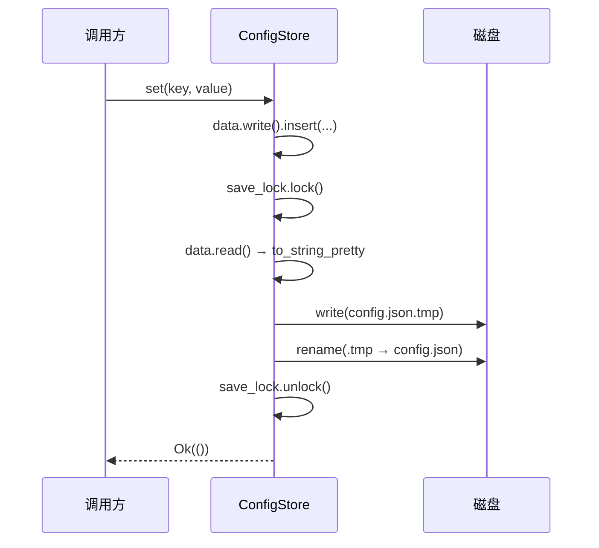

# oxidict-core 架构

> 面向维护者。使用者入口见 [README.md](./README.md)。

## 1. 定位

整条依赖链的**叶子**。不依赖任何内部 crate，也不依赖 gpui-kit / Tauri。
后果是三条硬性质，改动时不能破坏：

1. 内核可脱离窗口运行 → CLI（`--translate`）、本地 HTTP、插件宿主都不必拉起渲染循环。
2. 内核可脱离配置单例运行 → 服务层的错误处理与解析逻辑能单测。
3. 任何人都能依赖它，它不能反过来依赖任何人 → 一旦反向依赖立刻成环。

## 2. 文件职责

| 文件 | 行数 | 职责 | 对外导出 |
| --- | --- | --- | --- |
| `lib.rs` | 200 | crate 门面：`ServiceKind`、`TlsProfile`、re-export | `ServiceKind`（全项目唯一的服务种类枚举）、`TlsProfile` |
| `language.rs` | 323 | 统一语言码表 + `map_language!` 宏 | `Language`（`all()` / `ALL` / `code()` / `from_code()` / `english_name()` / `flag()` / `display_name()`） |
| `config.rs` | 579 | `ConfigStore` + `keys` 模块 + `watch_config` + 路径工具 | `ConfigStore`、`config()`、`store_opt()`、`set_global()`、`default_app_dir()`、`runtime_lock_path()`、`parse_instance()`、`keys::*`（62 个常量） |
| `model.rs` | 338 | 领域模型 + 四类请求 + `HasConfig` | `TranslateResult`、`DictResult`、`Pronunciation`、`Explanation`、`Sentence`、`ServiceConfig`、`StreamSink`、`*Request`、`HistoryEntry`、`HasConfig` |
| `schema.rs` | 78 | 声明式表单描述 | `ConfigField`（`Text` / `Select` / `Switch` / `Number`）+ 构造器 `text()` / `secret()` / `select()` / `switch()` / `number()` |
| `history.rs` | 155 | sqlite 历史库 | `History`（`init` / `init_default` / `global` / `add` / `list` / `search` / `delete` / `clear` / `count`） |
| `i18n.rs` | 213 | Fluent 本地化 | `LANGUAGES`（20 项）、`t` / `t_args` / `set_language` / `language` / `init_from_config` |
| `backup.rs` | 107 | 备份打包/解包 | `pack` / `unpack` / `export_to_file` / `import_from_file` |
| `runtime.rs` | 32 | 全局 tokio runtime | `handle()` / `spawn()` |
| `error.rs` | 62 | 统一错误 | `Error`（13 个变体）/ `Result` / `Error::is_retryable()` |

合计 **2,102 行**，是第三大 crate（仅次于 `oxidict-services` 7,752 行与 `oxidict-ui` 6,219 行）。
大头在配置与语言表这类「数据即代码」的部分，不是逻辑复杂度。

> 全部 8 个包共 **19,937 行 Rust**（不含 `target/`）。

## 3. 三条关键的内部链路

### 3.1 配置的生命周期

```mermaid
stateDiagram-v2
    [*] --> 装载: ConfigStore::init() / init_with_path()
    装载 --> 解析失败: serde_json 报错
    装载 --> 就绪: 解析成功 / 首次启动
    解析失败 --> 就绪: 原文改名 .json.corrupt，以默认配置启动
    就绪 --> 就绪: apply_defaults()（只 or_insert，不覆盖既有键）
    就绪 --> 就绪: set()/remove() → save()（.tmp + rename，save_lock 串行）
    就绪 --> 就绪: 外部改动 → watch_config → reload()
```

**单例语义**：`STORE: OnceCell<Arc<ConfigStore>>`。`init_with_path` 若发现已初始化会直接返回既有
实例——否则会出现「本次返回值与 `config()` 指向两个不同 store」的隐性分裂，表现为「改了设置却不生效」。

### 3.2 实体挂载：谁持有什么

```
ConfigStore
├── path: <config_dir>/net.oxidict.app/config.json
├── data: RwLock<Map<String, Value>>        ← 全部配置都在这一层 JSON 里
└── save_lock: Mutex<()>                    ← 只保护「快照→写→rename」这一段的原子性

app_dir()   = path.parent()                  → <config_dir>/net.oxidict.app
plugin_dir()= app_dir()/plugins              → 插件安装根
History     = app_dir()/history.db           ← 由 app 在启动时装
```

### 3.3 一次配置写入的时序



「取快照 → 写 → rename」必须整段在 `save_lock` 内。否则两个并发 `set` 各自快照、先后 rename，
先取的旧快照若最后落地，就会把后写的键**整段抹掉**（配置丢失，且内存与磁盘从此不一致）。

## 4. 不变量与契约

标 ✅ 的已有测试把守，改动时先跑测试。

| # | 不变量 | 违反后果 | 测试 |
| --- | --- | --- | --- |
| 1 | `apply_defaults` 只 `or_insert`，不覆盖既有键 | 老用户的配置与未知键被清掉 | — |
| 2 | `config.json` 解析失败必须留档 + 以默认配置启动 | 直接 `unwrap_or_default()` 会立刻落盘覆盖用户全部配置 | — |
| 3 | `reload()` 解析失败返回错误且**不改内存数据** | 监听线程可能在文件写到一半时触发，清空后配置全丢 | — |
| 4 | `watch_config` 只认文件名为 `config.json` 的事件 | 写日志自激：写日志 → reload → 回调写日志 → … | ✅ `only_config_json_triggers_watch_callback` |
| 5 | `watch_config` 忽略 `config.json.tmp` / `.bak` / `.1` | 保存流程先写 `.tmp` 再 rename，多触发一次 reload | ✅ 同上 |
| 6 | `watch_config` 忽略 `Access` 类事件 | 读文件也触发 reload | ✅ 同上 |
| 7 | `HasConfig` 缺失键/类型不符按默认处理，不 panic | 一个服务配错字段导致整条翻译崩掉 | ✅ `has_config_reads_typed_values` |
| 8 | `require_str` 拒绝空白字符串 | 空 API Key 被当成合法值发出去 | ✅ `require_str_rejects_blank` |
| 9 | `TranslateRequest` 默认 `TlsProfile::Native` | 调官方 API 白付一次浏览器握手代价，还可能因头部与文档不符而出错 | ✅ `translate_request_defaults_to_native_tls` |
| 10 | `TlsProfile::from_code` 对未知值回退 `Native` | 一个拼写错误让所有请求「假装是 Safari」，排查方向被带偏 | — |
| 11 | `DictResult::as_text()` 顺序：音标 → 释义，多义项用 `"; "`，末尾 `trim` | 复制/朗读/写历史的内容变形 | ✅ `dict_result_flattens_pronunciations_then_explanations` |
| 12 | `parse_instance` 以 `@` 切分：`alibaba@r4nd0m` → (`alibaba`, Some(`r4nd0m`)) | 带备注的实例解析错，服务找不到 | — |
| 13 | 新文案只需补 `zh-CN` 与 `en-US`，其余 18 个回退 `en-US` | 20 个文件都要改 | ✅ `i18n::tests`（键集一致性 + UI 引用的键可解析） |

> `Language` 与 `TlsProfile` 放在 core 而非各自的消费层，是因为**请求结构体要携带它们**
> （`TranslateRequest.tls`），而 `oxidict-net` 依赖 core（反向不成立）——放网络层会成环。

## 5. 设计决策记录

| 决策 | 理由 | 被否决的方案 |
| --- | --- | --- |
| 语言码收敛为单一枚举 + `map_language!` 宏 | 原实现散落 5 处（内部码、各服务 `info.ts` 枚举、`recognize/system` 三套平台码、`lang_detect.js` 厂商码、Rust lingua 映射），改一个语言要动 5 个地方 | 每服务自带语言表（现状，散） |
| 服务表单改为 `ConfigField` 声明 | 原版 30 份手写 `Config.jsx` 高度同构，改一个字段要改 30 处 | 每服务手写表单 |
| 配置整体放一个 `Map<String, Value>` | 与老版 `config.json` 结构逐键对齐；未知键原地保留，向前兼容零成本 | 强类型 struct（未知键会丢，老配置无法无损往返） |
| 落盘用 `.tmp` + `rename` | 崩溃时不会写坏 `config.json` | 直接 `write` |
| `i18n` 用 Fluent 而非 JSON 键值 | 内置复数/占位/回退，字符串带语法 | react-i18next 风格的 JSON（原实现） |
| 语言检测用 `lingua` 离线 | 无网络依赖、无隐私外传 | 调云端检测接口 |

## 6. 已知限制

- **`ui_language` / `app_fallback_font` / `aliyun_*` 是兼容保留键**：读不读、会不会被清掉，
  见根 README「兼容但尚未生效的配置项」。删键要慎重——老用户的 `config.json` 里还在。
- **`History` 用单个 `Mutex<Connection>`**：所有历史读写串行。当前调用频率（每次翻译一条）远未构成瓶颈，
  但不要把它用在批量导入路径上。
- **`backup.rs` 打包包含 `plugins/`**：恢复会把插件目录一并覆盖，这是与原版一致的行为，不是 bug。
- **`watch_config` 用 `std::mem::forget` 让 watcher 常驻**：没有关机路径；进程退出时随进程释放。

## 7. 扩展点

| 想加什么 | 改哪里 | 注意 |
| --- | --- | --- |
| 新配置键 | `config.rs::keys` + `apply_defaults` 里的默认值 | `apply_defaults` 只 `or_insert`，老配置不会被改动 |
| 新语言 | `language.rs::Language` 枚举 + `ALL` + 各码 `code()` / `english_name()` / `flag()` | `Language::ALL` 的顺序与原版 `languageList` 一致，UI 语言选择器依赖它 |
| 新服务类别 | **不建议**——`ServiceKind` 是四类服务的封闭集合，注册表、设置面板、插件目录都按它索引 | 加第五类要同时改 4 处（core / services 注册表 / 设置窗口 / 插件目录） |
| 新 locale | `locales/<tag>/main.ftl` + `i18n.rs::LANGUAGES` | 只有 `zh-CN`/`en-US` 需要完整，其余按块翻译 |
| 新的表单字段类型 | `schema.rs::ConfigField` + `oxidict-ui/config_window/services.rs` 的渲染分支 | 两边必须同时改，否则新变体不会被渲染 |
