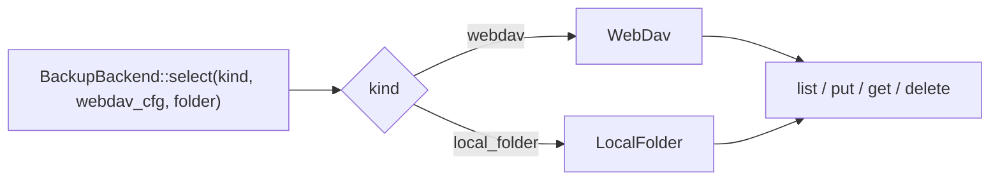

# oxidict-net 架构

> 面向维护者。使用者入口见 [README.md](./README.md)。

## 1. 定位

网络层。把原实现中「JS 侧 `@tauri-apps/api/http` 发请求 + `crypto-js` 签名」这两件事
完整搬到 Rust，服务实现里不再出现脚本代码。依赖方向上是 core 的**唯一直接消费者之一**
（另一个是 platform），本身不依赖 services/platform。

## 2. 文件职责

| 文件 | 行数 | 职责 |
| --- | --- | --- |
| `lib.rs` | 22 | 门面：模块声明 + 平铺 re-export（调用方写 `get_json` 而不是 `http::get_json`） |
| `http.rs` | 354 | 客户端构建与按档位缓存、`emulation()` 指纹档案映射、请求便捷函数、SSE 解析、`NetErr` |
| `sign.rs` | 381 | 全部签名算法（HMAC / MD5 / SHA256 / AWS SigV4 / 腾讯 TC3 / 阿里云转义 / 编码 / 时间戳 / UUID） |
| `webdav.rs` | 196 | WebDAV 协议（`MKCOL` / `PROPFIND` / `PUT` / `GET` / `DELETE`）+ PROPFIND XML 解析 |
| `backup_backend.rs` | 281 | 备份后端枚举（`webdav` / `local_folder`）+ 工厂 + 统一 list/put/get/delete |

## 3. HTTP 层结构

### 3.1 客户端缓存

```
CLIENTS: RwLock<Vec<(TlsProfile, Arc<Client>)>>     # 最多 3 项，线性扫描
```

选 `Vec` 而不是 `HashMap`：只有 3 个档位，规模上没必要引入哈希表。

`client_for(profile)` 是**双检查锁**：先读锁找，未命中再写锁，写锁内再查一次
（另一线程可能刚建好），然后 `build_client` 并推入。

`rebuild_client()` 清空整张表——**指纹档位也一并清掉**：代理与指纹属于同一层配置，
只失效代理会让「改了代理但指纹档位还用旧 client」这种不一致极难排查。

### 3.2 客户端的三段配置

```mermaid
graph TD
    b["Client::builder()"] --> t["timeout 30s / connect_timeout 10s"]
    t --> ck["cookie_store(true)"]
    ck --> br{profile.is_emulated()?}
    br -->|是| em["emulation(Emulation::builder()<br/>.profile(Chrome131/Safari26)<br/>.platform(当前系统))"]
    br -->|否| ua["user_agent(DEFAULT_UA)"]
    em --> px["可选代理（store_opt().proxy()）"]
    ua --> px
    px --> build["build() 失败则 warn + 回退 Client::new()"]
```

四个值得记住的点：

| 点 | 理由 |
| --- | --- |
| Cookie 罐**按域名隔离**（wreq 默认行为） | 多服务共享同一 client 不会跨域串 Cookie；而多步会话（先取会话再发主请求）正依赖 Cookie 被自动带过去 |
| 模拟档把 UA/Accept/client hints 一起交给 emulation | 保证「连接特征 + 头部」自洽，而不是拼出来的四不像 |
| 平台串跟随 `cfg!(target_os)` | macOS 上跑却声称自己是 Windows，反而更容易被判定异常 |
| `build()` 失败不 panic，只 warn 后回退 | 构建失败极罕见（TLS 后端初始化），但静默回退会丢掉 UA/超时/代理全部配置且无从排查，所以至少要把原因记下来 |

`emulation()` 里 `TlsProfile::Native` 分支是**逻辑上不可达**的（调用方只在 `is_emulated()` 时才走到），
真出现时给 `Chrome131` 而不是 panic——指纹不匹配只是可能被拦，panic 会让整个翻译流程崩掉。

### 3.3 请求函数族

命名规律：**`*_for(profile, ...)` = 指定指纹档；不带后缀 = 原生档**。

| 分类 | 函数 |
| --- | --- |
| 便捷取数据 | `get_json` / `get_value` / `get_text` / `get_bytes` / `post_json` / `post_json_value` / `post_form` |
| 指定档位版 | `get_value_for` / `get_text_for` / `get_bytes_for` / `post_json_value_for` |
| 拿 `RequestBuilder` 自行拼装 | `get_with_headers(_for)` / `post_with_headers(_for)` / `request_with_headers(_for)` |
| 响应校验 | `check(resp)` |
| 流式 | `sse_text(resp)` → `Stream<Item = Result<String>>`、`sse_payload(line)` 取 `data:` 载荷 |
| 错误映射 | `NetErr::net_err()` |

### 3.4 错误映射的分层理由

```rust
pub trait NetErr<T> { fn net_err(self) -> Result<T>; }
impl<T> NetErr<T> for std::result::Result<T, wreq::Error> { ... }
```

core **不依赖 wreq**（它只管领域模型），所以 `wreq::Error → Error::Network` 的转换必须放在这一层。
给 `oxidict_core::Error` 加 `impl From<wreq::Error>` 会把 wreq 拖进 core——破坏「core 是叶子」这条规则。

`check()` 把非 2xx 转成 `Error::Http { status, body }`，body **截断到 512 字节**，避免一个巨大的
错误页面把日志撑爆。

## 4. 签名层

按用途分组，全部是纯函数（好测、无状态）：

| 分组 | 函数 |
| --- | --- |
| HMAC | `hmac_sha1_base64` / `hmac_sha256_base64` / `hmac_sha256_hex` / `hmac_sha256_raw` |
| 哈希 | `sha256_hex` / `empty_sha256` / `md5_hex` / `md5_hex_bytes` |
| 编码 | `percent_encode` / `alibaba_escape` |
| 随机/时间 | `uuid_v4` / `alibaba_nonce` / `unix_seconds` / `iso_utc_now` / `aws_now` / `aws_date` |
| AWS SigV4 | `derive_aws_key` → `aws_sign` → `AwsSignature` |
| 腾讯云 | `tc3_sign` |

### 两条硬约束

**1. `uuid_v4()` / `unix_seconds()` 在一次请求内只能取一次。**
签名模板里同时出现 `{{salt}}` 与 `{{timestamp}}` 时（例如有道 `hash_query`），调用方必须
先各取一次再拼进**所有**位置。每次引用都重新生成会让签名对不上，而服务端只回一个笼统的
「签名错误」，极难定位。

**2. `percent_encode` 与 `alibaba_escape` 不可互换。**
阿里云要求 `~` 不转义、空格编码为 `%20`，与标准 `urlencoding`（RFC 3986）行为不同。
这是它单独存在的原因，不是冗余实现。

## 5. WebDAV 层

```
dav_url(base, path)       # 拼 URL，容忍两端斜杠
mkcol() / propfind()      # 自定义 method 的常量构造（expect 有静态不变量保证）
ensure_dir(cfg)           # MKCOL oxidict-app，失败静默（目录已存在时服务器会返错）
list(cfg)                 # PROPFIND Depth:1 → parse_zip_names
put / get / delete        # PUT / GET / DELETE，统一 basic_auth
```

### `parse_zip_names` 为什么值得单独说

它用**手写的字符串扫描**而不是引入 xml crate，且必须同时容忍三种写法：

| 服务器 | 返回 |
| --- | --- |
| Nextcloud / SabreDAV | `<d:href>`（小写前缀） |
| Apache mod_dav | `<D:href>`（大写前缀） |
| 部分实现 | `<href>`（无前缀） |

**只认某一种写法会让「云端备份列表」在多数服务器上恒为空，恢复功能静默失效**——
这正是它配了 4 个测试的原因（三种写法 / 忽略目录与非 zip / 排序 / 空列表）。

排序也有语义：备份名形如 `oxidict-backup-<UTC 时间戳>.zip`，**字典序即时间序**，
排序后调用方取 `.last()` 才能可靠拿到「最近一次」，不能依赖服务器返回顺序。

## 6. 备份后端



| 变体 | 落点 | 实现 |
| --- | --- | --- |
| `WebDav` | 远端 `oxidict-app/` 目录 | `webdav.rs` |
| `LocalFolder` | 本机 `backup_folder` | 直接文件 IO |

`LocalFolder` 的语义是**让用户把备份放进系统已在同步的目录**（iCloud Drive / OneDrive /
坚果云本地目录），由系统负责上云——这正是原版 `backup_type` 里 `local_folder` 那一档的含义，
不是「多一种云」。

**enum 派发 vs `dyn Trait`**：参考实现 clippi 的后端集合运行期可增（`Vec<BackendConfig>` + `dyn Trait`），
本工程的启用后端由**单一** `backup_type` 决定、集合封闭，所以用 enum：省掉 boxed future，
`match` 还能保证穷尽性。将来要变多后端并存，再引入 trait 不迟。

## 7. 不变量与契约

| # | 不变量 | 违反后果 | 测试 |
| --- | --- | --- | --- |
| 1 | 未知 `tls` 值回退 `Native` | 所有请求「假装是 Safari」，排查方向被带偏 | — |
| 2 | 代理/指纹变更后必须 `rebuild_client()` | 新配置不生效 | — |
| 3 | 客户端构建走 `store_opt()` 而非 `config()` | 未初始化配置时 panic（测试、独立工具都会走到） | — |
| 4 | `check()` 的 body 截断 512 字节 | 巨大错误页撑爆日志 | — |
| 5 | `PROPFIND` 解析大小写不敏感、容忍命名空间前缀 | 云端备份列表恒为空 | ✅ 4 个测试 |
| 6 | `parse_zip_names` 结果排序 | 调用方 `.last()` 拿不到最近备份 | ✅ `sorts_by_name_so_last_is_latest` |
| 7 | `uuid_v4`/`unix_seconds` 每请求只取一次 | 签名对不上 | — |
| 8 | `percent_encode` 与 `alibaba_escape` 不混用 | 阿里云签名失败 | — |

## 8. 已知限制

- **除纯函数与缓存外无法自动化验证**：真实请求/响应/流式靠端到端手工验证。现有测试分布为
  `sign.rs` 10 / `webdav.rs` 4 / `backup_backend.rs` 4 / `http.rs` 1，
  **空白点是 `http.rs` 的请求便捷函数族与 SSE 解析**（`sse_text` / `sse_payload`）。
- **BoringSSL 构建门槛**：三平台都需要 `cmake` + `perl` + `libclang` + `git`（macOS 装 Xcode CLT 即可）。
- **根证书是 `chromium-roots`**（Chrome 的根证书集），与系统信任库不同：企业 MITM 证书场景需自行验证。
- **依赖作者自维护的 `btls` fork**，且 wreq 是硬分叉——reqwest 的安全补丁不会自动过来，升级要手动跟。
- **`picky` 级别的 WAF 无法绕过**：wreq 覆盖 L1 传输层指纹与 L2 header 形态；L3 会话/Token、
  L4 HTML 响应体、L5 风控挑战（Cloudflare/hCaptcha）、L6 速率限制都要另外做。

## 9. 扩展点

| 想加什么 | 改哪里 |
| --- | --- |
| 新指纹档位 | `oxidict_core::TlsProfile` 加变体 + `http.rs::emulation()` 映射 + `services::TLS_OPTIONS` 加上端选项（**三处必须同步**） |
| 新签名算法 | `sign.rs` 新增纯函数 + 补单测 |
| 新备份落点 | `backup_backend.rs` 加枚举变体 + `select()` / `list` / `put` / `get` / `delete` 的分派分支 + `config::keys` 里的配置项 |
| 新的 HTTP 便捷函数 | `http.rs` + `lib.rs` 的 re-export（两处都要改） |
