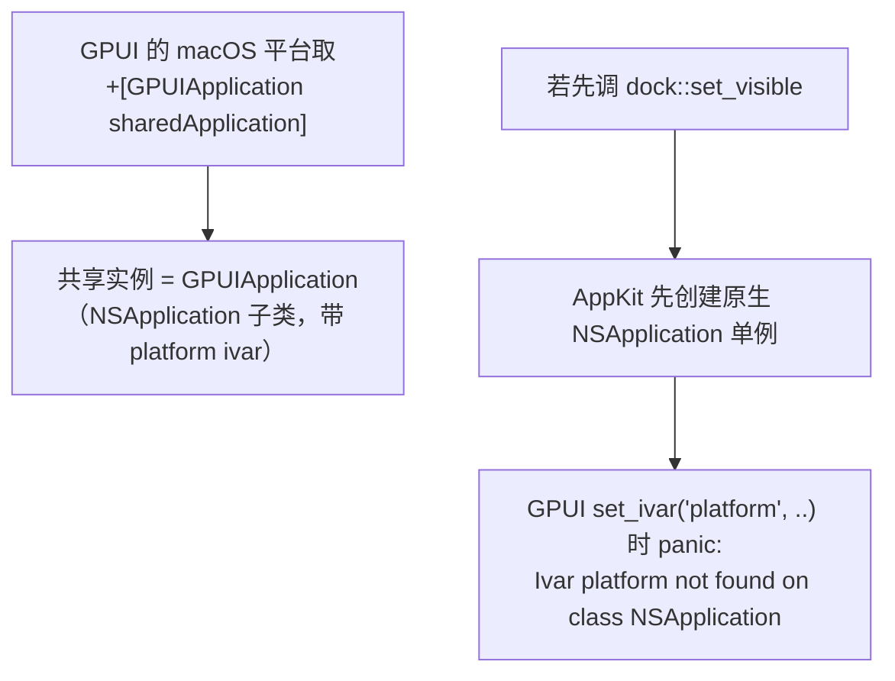

# oxidict-platform 架构

> 面向维护者。使用者入口见 [README.md](./README.md)。

## 1. 定位

跨平台系统能力层。**只依赖 `oxidict-core`，不依赖 gpui-kit**——CLI、HTTP 服务、插件宿主
都要调到它，不该被拖进渲染循环。

设计形态：一组**自由函数**（不是 trait / 不是 struct），按 `cfg(target_os = ...)` 在函数体内分派。
选自由函数而非特权抽象的理由：调用点只需 `platform::selection::selected_text()`，
没有状态、没有生命周期、没有需要 mock 的依赖——`trait + dyn` 在这里只会增加噪音。

## 2. 文件职责

| 文件 | 行数 | 平台分派方式 |
| --- | --- | --- |
| `lib.rs` | 43 | 门面 + **平台能力矩阵文档**（改动能力时同步更新那张表） |
| `selection.rs` | 19 | 单实现（`selection` crate 内部已分平台） |
| `screenshot.rs` | 85 | 单实现 + `cfg(unix)` 的交互式框选分支 |
| `ocr.rs` | 35 | `cfg` 分派 → `ocr/{macos,windows,linux}.rs` |
| `ocr/macos.rs` | 72 | **命令回退**（见 §6） |
| `ocr/windows.rs` | 49 | `windows` crate → `Windows.Media.Ocr` |
| `ocr/linux.rs` | 40 | `tesseract` 命令行 |
| `hotkey.rs` | 438 | 单实现（keytap 自带三平台后端）——**本 crate 最大的文件** |
| `clipboard.rs` | 56 | 单实现（`arboard` 轮询 + 去抖），返回 `MonitorHandle` |
| `mouse.rs` | 29 | 单实现（`mouse_position`） |
| `detect.rs` | 73 | 单实现（`lingua` 离线） |
| `dock.rs` | 66 | `cfg(macos)` 有实现，其余 no-op |
| `autostart.rs` | 70 | `cfg` 三实现（LaunchAgent / 注册表 / `.desktop`） |
| `shell.rs` | 15 | `cfg` 三分支（`open` / `explorer` / `xdg-open`） |
| `examples/tap_probe.rs` | 31 | 快捷键 tap 的独立探针，排查权限与事件问题 |

## 3. 快捷键子系统（`hotkey.rs`，最复杂的一个）

### 3.1 观察流模型

`keytap` 是**观察流制**（监听全局键盘事件后自己匹配），不是注册制（向系统注册组合键）。
这带来三个语义差异，都是刻意的：

| 语义 | 行为 |
| --- | --- |
| 触发时机 | 按下组合键的**非修饰键瞬间**触发一次；auto-repeat（`KeyRepeat`）不触发 |
| 修饰键归一化 | 左右键合一（`Mod::Control` 不区分 left/right） |
| 匹配是**超集** | 按 `Shift+Alt+X` 也能触发已注册的 `Alt+X`（比注册制的精确匹配更宽容） |

### 3.2 内部结构

```
REGISTRY: Lazy<Registry>
├── bindings: Mutex<HashMap<name, Binding>>     # 事件线程查这张表
│     └── Binding { mods: HashSet<Mod>, key: Key, handler: Arc<dyn Fn() + Send + Sync> }
├── started: AtomicBool                          # Tap 只创建一次，常驻到进程退出
└── permission_notice_shown: AtomicBool          # 权限告警只输出一次（否则每次 register 都刷屏）
```



```mermaid
sequenceDiagram
    participant C as 调用方(ui/app)
    participant R as REGISTRY
    participant T as keytap 事件线程
    C->>R: register(name, "Alt+X", handler)
    R->>R: parse(accelerator) → (HashSet<Mod>, Key)
    R->>R: 首次调用 → start_event_loop()
    R->>T: 启动 Tap（专用 CFRunLoop / 消息泵 / evdev 线程）
    Note over R: 权限不足 → request_input_monitoring() 主动请求<br/>并记一次告警，register 本身不失败
    T->>R: KeyDown 事件
    R->>R: 跳过修饰键 / 跳过 KeyRepeat<br/>归一化修饰键 → 超集匹配 bindings
    R->>C: handler()
```

### 3.3 关键设计点

| 点 | 理由 |
| --- | --- |
| `started: AtomicBool` 保证 Tap 只创建一次 | Tap 常驻到进程退出；重复创建会拿到多个事件源，handler 被调多次 |
| `permission_notice_shown` 去重告警 | 未授权时每次 `register`（启动时有 4 个快捷键）都会重试，不去重会刷屏 |
| **主动** `request_input_monitoring()` | 有些库只 `IOHIDCheckAccess`（检查）不 `IOHIDRequestAccess`（请求），此时系统授权弹窗**永不出现**——用户只看到报错却找不到入口。所以这里自己声明 IOKit FFI 主动请求一次（`kIOHIDRequestTypeListenEvent = 1`） |
| `unregister(name)` | 设置窗口改键后要能摘掉旧绑定 |
| `find_conflict(accelerator, expect_name)` | 给设置页做冲突提示 |

### 3.4 快捷键字符串

沿用用户配置里的写法：`Ctrl+Alt+T`、`Command+Shift+D`、`Alt+X`。
`parse()` / `parse_key()` / `letter()` / `digit()` / `fn_key()` 是**纯函数**——这是本文件里最适合
补单测的部分（当前缺）。

> `oxidict-ui::hotkey` 负责**录入**（按键 → 字符串），本模块负责**生效**（字符串 → 绑定）。
> 两边共用同一套字符串格式，`ui::hotkey::to_accelerator` 的产物直接兼容 `parse()`。

## 4. 剪切板与鼠标

```
clipboard::start_monitor(callback) -> MonitorHandle
    └── 轮询 arboard 文本 → 内容变化才回调 → 去抖
    └── MonitorHandle: Drop 即停止轮询线程

mouse::cursor_position()      -> (i32, i32)     # 系统全局坐标
mouse::monitor_at_cursor()    -> Option<MonitorInfo>
     MonitorInfo = ((x, y), (w, h), scale_factor)
```

坐标域问题在 UI 侧处理，但根因在这里，**必须记住**：

- macOS 是 **points**（与 gpui 逻辑坐标同域）；
- Windows / Linux 是**物理像素**，需除以 `scale_factor`。

`oxidict-ui::lib::mouse_follow_origin` 按平台做了这个换算。近似处理，边缘 clamp 偶有细微偏差。

## 5. 平台隔离的工程约定

### 5.1 平台特定依赖写在本 crate 的 `Cargo.toml`

virtual workspace manifest **不允许** `[target]` 区块，所以 `windows` / `objc2` / `objc2-app-kit`
必须写在各成员 crate 自己的 manifest 根 `Cargo.toml` 里。

### 5.2 `dock.rs` 的时序约束（**启动即崩的历史事故**）

**不得在 GPUI `Application::run` 之前调用本模块。**



所以 Dock 策略在 GPUI 启动回调（`app/src/main.rs` 的 `.run(|cx| ..)`）内应用，`set_visible`
里还有主线程检查兜底。**改启动顺序前先读 `dock.rs` 顶部注释。**

### 5.3 权限按「负责进程」归属

从终端/IDE 启动的裸二进制，TCC 授权会记在**终端**身上。所以「用户报权限失败、开发者复现不了」
是正常现象，不能据此判定无 bug。验证要用 `.app` + ad-hoc 签名（见根 README）。

## 6. macOS OCR 的命令回退

`ocr/macos.rs` **不是**原生 Vision 实现，而是「写临时 PNG + 调用外部 OCR 助手」的回退方案。

理由是权衡而非能力不足：原生 Vision 需要 objc/CoreGraphics FFI 绑定，存在不可控的编译风险；
当时的选择是「**编译通过优先于实现华丽**」，保证本机 `cargo check` 稳定通过。

文件内已注释原生 `VNRecognizeTextRequest` 的**接入点**——要接手就从那里进。
替换后请同时更新 `lib.rs` 的平台矩阵表与本文件。

## 7. 不变量与契约

| # | 不变量 | 违反后果 | 把守方式 |
| --- | --- | --- | --- |
| 1 | `dock::set_visible` 只能在 GPUI `run` 之后、主线程调用 | **启动即 panic**（见 §5.2） | 注释 + 主线程检查兜底 |
| 2 | Tap 只创建一次（`started` 原子标志） | handler 被调用多次 | 代码 |
| 3 | 权限告警只输出一次 | 启动时 4 个快捷键各刷一次屏 | `permission_notice_shown` |
| 4 | `hotkey` 必须**主动**请求输入监控权限 | 系统弹窗永不出现，用户找不到授权入口 | `request_input_monitoring()` |
| 5 | auto-repeat 不触发 handler | 按住组合键会连续弹出多个翻译窗口 | keytap 事件过滤 |
| 6 | `MonitorHandle` Drop 即停止监听 | 应用退出后线程残留 | `Drop` 实现 |
| 7 | `MonitorInfo` 的坐标域差异由调用方换算 | 非 macOS 上窗口位置错乱 | 调用方 `to_logical` |
| 8 | 权限不足返回 typed `Error::PermissionDenied` | 静默失败，用户不知道要授权 | 错误类型 |

## 8. 已知限制

- **Windows / Linux 分支未经实机验证**（本机只有 macOS）。代码正确性只能靠 review。
- **鼠标释放钩子已整体撤除**（随 rdev）。划词触发改为「快捷键 / 托盘菜单 → `selected_text()`」，
  与原版热键划词行为一致，但**没有原版「选中即翻译」的自动触发**。
- **`autostart` 三平台实现都未做端到端验证**（尤其 Linux `.desktop` 的路径与权限）。
- **`hotkey` 的字符串解析只覆盖了 1 个用例**（`parses_punctuation_and_numpad`，
  覆盖标点与数字键盘）。`parse` / `parse_key` / `letter` / `digit` / `fn_key` 都是纯函数，
  但**组合键（`Ctrl+Alt+T`）、修饰键别名（`Command`/`Cmd`/`Meta`）、F1–F24、
  非法输入**这些分支没有测试——这是本 crate 最值得补的空白。
- `keytap` 的事件线程常驻，**没有反注册整个 Tap 的路径**（`Drop` 即注销的是 Tap 句柄，
  但本模块用 `Lazy` 常驻到了进程退出）。

## 9. 扩展点

| 想加什么 | 改哪里 | 注意 |
| --- | --- | --- |
| 新平台能力 | 新建 `xxx.rs` + 在 `lib.rs` 声明模块并更新平台矩阵表 | 优先做成自由函数，保持无状态 |
| 新的快捷键触发键名 | `hotkey.rs::parse_key`（含 `letter` / `digit` / `fn_key` 辅助） | 顺便补单测 |
| 替换 macOS OCR 为原生 Vision | `ocr/macos.rs` 的接入点 | 改完同步 `lib.rs` 与 README 的矩阵表 |
| 新的系统集成（如通知中心） | 新建模块，`cfg` 分派 | 注意主线程约束（macOS 的 AppKit 大多要求主线程） |
