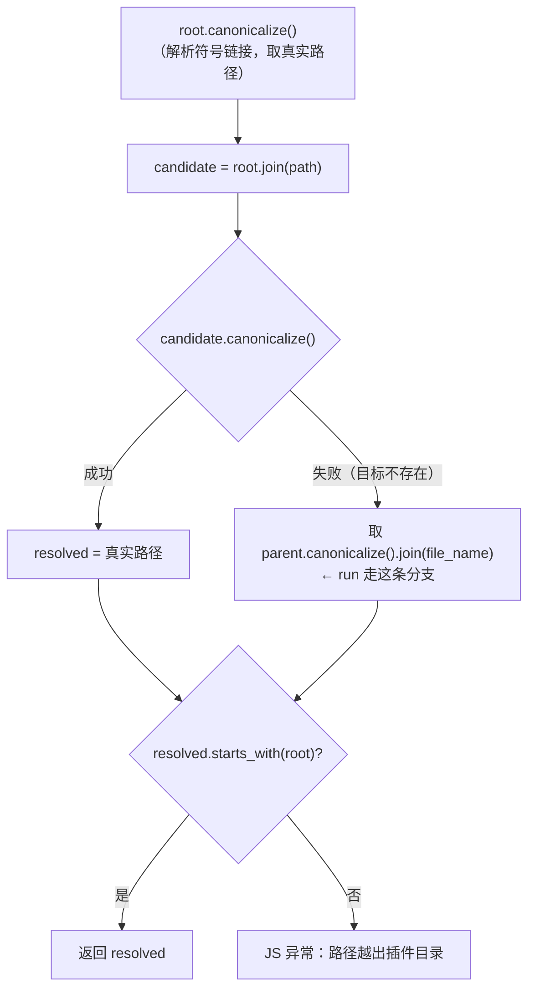
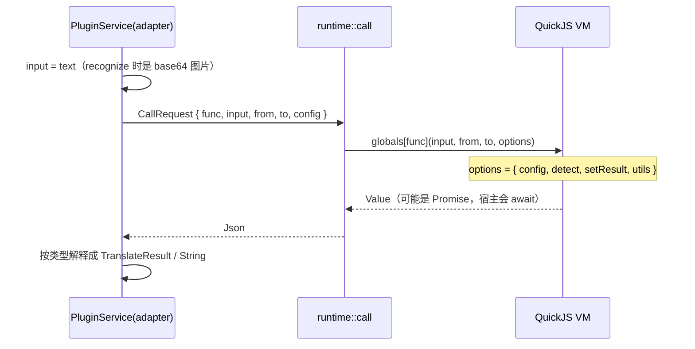

# oxidict-plugin 架构

> 面向维护者。使用者入口见 [README.md](./README.md)。

## 1. 定位

`.potext` 插件宿主。基于 rquickjs（QuickJS），**不依赖窗口与渲染循环**——
这是相对上一代 gpui-shell 方案的本质区别（那时所有插件 View 挤在 GPUI 主线程）：
现在 CLI / HTTP / UI 三种上下文行为一致。

依赖方向：`oxidict-plugin → oxidict-services + oxidict-net + oxidict-core`。
依赖 services 是为了**实现它的 trait**（插件对注册表是同构的普通服务），不是反向被依赖。

## 2. 文件职责

| 文件 | 行数 | 职责 |
| --- | --- | --- |
| `lib.rs` | 73 | 门面 + `Error`（`Plugin`/`Io`/`Json`）+ `load_installed()` + `From<Error> for oxidict_core::Error` |
| `runtime.rs` | 270 | 专职插件线程、`HashMap<plugin_id, PluginVm>`、load/call/unload、30s 超时 |
| `host.rs` | 294 | 宿主能力面：`oxidict` 原生模块 + 全局对象 + legacy `utils` + **路径越界防护** |
| `adapter.rs` | 145 | `PluginService` 实现四个 trait（返回值解释） |
| `install.rs` | 124 | `.potext` 安装/卸载/列举 + **四道校验** |
| `tests/runtime.rs` | 119 | 集成测试：VM 加载与调用链路 |

## 3. 线程与 VM 模型

### 3.1 为什么所有 VM 挤在一个线程

rquickjs 的 `AsyncRuntime` 在默认（非 parallel）配置下是 **`!Send`**，无法跨线程持有。
因此：所有 VM 固定在一个专职线程上，调用方通过 `mpsc` 提交请求、`oneshot` 回传结果。

```mermaid
graph TD
    subgraph 调用方线程
        ui["UI（GPUI 执行器）"] --> call["runtime::call(CallRequest).await"]
        cli["CLI / 启动流程"] --> load["runtime::load(id, dir)  阻塞"]
    end
    call -->|"mpsc::unbounded"| th
    load -->|"mpsc + block_on(oneshot)"| th
    subgraph 插件线程["插件线程」(oxidict-plugin)」"]
        th["plugin_loop"] --> map["HashMap&lt;plugin_id, PluginVm&gt;"]
        map --> vm["PluginVm { _rt: AsyncRuntime, ctx: AsyncContext }"]
    end
    th -->|"oneshot"| call
    th -.->|"unload 直接移出 map"| map
```

| 点 | 说明 |
| --- | --- |
| 插件线程自建 runtime | `tokio::runtime::Builder::new_current_thread()`，**不走** `oxidict-core::runtime` 的全局多线程 runtime |
| `HOST` 是 `Lazy<HostHandle>` | 首次用到时 spawn 线程，之后常驻 |
| 请求**顺序处理** | 与旧 gpui-shell 方案的串行度相同。插件数量上来可升级为 `LocalSet` + `spawn_local` 并行 |
| 30 秒超时 | `CALL_TIMEOUT`，在**调用方**一侧控制（`tokio::time::timeout`），避免插件挂死拖住翻译面板 |
| `unload` 无回执 | 直接从 map 里 `remove`，VM 随最后一个引用销毁 |

### 3.2 `runtime::load` 的线程约束

内部是 `oxidict_core::runtime::handle().block_on(reply_rx)`：

- 可在 CLI 与 GPUI 主线程等**非 tokio 上下文**调用；
- **在 tokio 工作线程或 `block_on` 内部调用会 panic**（调用点必须在独立线程上）。

`app` 的启动流程（主线程，早于 GPUI `run`）符合这个前提。

## 4. 宿主能力面

三种注入方式并存，插件按习惯任选——这不是冗余，而是为兼容老插件：

| 方式 | 写法 | 备注 |
| --- | --- | --- |
| ESM 原生模块 | `import { http_request, read_text_file, run, utils } from "oxidict"` | loader 只挂了 `BuiltinResolver::with_module("oxidict")`，**没有 FileResolver** |
| 全局对象 | `globalThis.oxidict.http_request(...)` | 老宿主是 `eval(main.js)` 的脚本语义，插件不能 `import`，这是主要途径 |
| legacy `utils` | 入口函数的 `options.utils` 里 | 与老 Tauri 宿主的形状对齐 |

| 能力 | 实现 | 边界 |
| --- | --- | --- |
| `http_request(method, url, headers, body?)` | 宿主代发（`oxidict-net` / wreq） | **脚本自身零网络权限** |
| `read_text_file(path)` | `std::fs::read_to_string` | 限定在插件目录内 |
| `run(program, args...)` | `std::process::Command` | 可执行文件必须**位于插件目录内** |
| `utils.{cacheDir, pluginDir, osType}` | 常量注入 | — |
| `console.{log,info,warn,error}` | 桥接到 `log` crate | QuickJS 标准库没有 console |

### 4.1 路径越界防护（安全关键）

`canonical_within(root, path)` 是唯一的守门函数：



**为什么不能用字符串 `starts_with`**：`root.join("../../etc/passwd")` 在字符串上仍以 root 开头，
但 `open` 时会沿 `..` 逃出目录。必须 `canonicalize` 解析真实路径后再比较——这同时覆盖了
符号链接逃逸。目标不存在时退化为「规范化父目录 + 文件名」，保证尚不存在的路径同样无法越界。

### 4.2 `http_request` 的一个历史坑

**保留调用方指定的 HTTP 方法**（`request_with_headers(&method, ...)`，非法方法才报错）。
早期实现把非 POST 一律降级成 GET，会让插件的 `PUT`/`DELETE` 静默变成 GET，
而服务端往往仍返回 2xx，问题极难定位。

### 4.3 与 legacy（Tauri）宿主的差异

未实现：`utils.tauriFetch` / `utils.readBinaryFile` / `utils.CryptoJS`——用到它们的插件会得到
`undefined`。迁移做法是改用 `oxidict.http_request` / `oxidict.read_text_file`。

## 5. 调用协议



**返回值的解释**（`adapter.rs`）：

| JS 返回 | 映射 |
| --- | --- |
| `string` / `null` | `TranslateResult::Plain` |
| 对象 | 按 `{ pronunciations, explanations, associations, sentence }` 反序列化成 `DictResult`，各字段解析失败退化为空列表（**不报错**） |
| 其它 | 尽力 `as_str`，否则当空词典 |

同步与 async 入口函数都支持：`out.is_promise()` 时走 `into_future().await`。

**错误转换**：`plugin_js_error` 在 `Error::Exception` 时用 `Ctx::catch()` 取回被抛出的值，
拼出 `message + stack`——否则用户只看到「JS 异常」而没有行列信息。这是插件调试的主要线索。

## 6. 安装与校验

```
.potext (zip)
├── info.json      # 可选；{"id": "plugin_xxx"}
└── main.js        # 必须存在
        ↓ 解压到临时目录 → 校验 → 拷贝到 plugins/<kind>/<plugin_id>/
plugins/translate/plugin_xxx/main.js
```

四道校验（早期漏掉任何一条都出过问题）：

| 校验 | 违反后果 |
| --- | --- |
| 包内必须有 `main.js` | 没东西可跑 |
| `info.id` 不得含 `/`、`\`、`..` | `plugin_id` 直接参与路径拼接，`{"id": "../../../.ssh"}` 能把文件写到插件目录之外 |
| `plugin_id` 必须以 `plugin` 开头 | 上游规则，加载侧也按此前缀过滤 |
| **校验对象是最终落盘的目录名**（`info.id`，缺省取文件名去掉 `.potext`） | 早期只校验文件名而加载侧按目录名过滤 → `info.id` 不合规的包**能装成功却永远不会被加载** |

## 7. 不变量与契约

| # | 不变量 | 违反后果 | 把守 |
| --- | --- | --- | --- |
| 1 | 所有宿主路径能力必须经 `canonical_within` | 插件可读/执行插件目录外的任意文件 | 代码（唯一入口 `resolve_in_plugin_dir`） |
| 2 | 保留调用方指定的 HTTP 方法 | `PUT`/`DELETE` 静默变 GET，2xx 掩盖问题 | 代码 |
| 3 | 脚本无网络权限，HTTP 必须由宿主代发 | 插件绕过代理/指纹配置直连外网 | 代码（不注入 fetch/XHR） |
| 4 | `load` 只能在非 tokio 上下文调用 | panic | 调用点约定 |
| 5 | 单次调用 30s 超时 | 插件挂死拖住翻译面板 | `CALL_TIMEOUT` |
| 6 | 插件 id 校验对象 = 落盘目录名 | 装得上却加载不了 | `install.rs` |
| 7 | 插件与内置服务在注册表里同构 | 调用方要区分两套，UI 分叉 | `PluginService` 实现四 trait |
| 8 | `unload` 必须把 VM 从 map 移除 | 卸载后 VM 常驻占内存 | `install.rs::uninstall` 会调 `runtime::unload` |

## 8. 已知限制

- **请求串行**：所有插件的所有调用在同一线程顺序执行。插件多/调用频繁时会互相阻塞；
  升级路径是 `LocalSet` + `spawn_local`（`runtime.rs` 顶部已注明）。
- **不支持模块相对导入**：loader 只挂了 `oxidict` 内置模块，没有 `FileResolver`——
  插件必须打成单个 `main.js`（与老宿主一致）。
- **legacy 三件套未实现**（`tauriFetch` / `readBinaryFile` / `CryptoJS`）。
- **`load_installed` 的失败会被静默跳过**（只记日志），插件 ID 与原因需要翻日志。
- **`PluginVm` 无内存/指令数上限**：恶意或死循环插件只能靠 30s 超时兜底，
  没有 QuickJS 的 interrupt handler 限制 CPU。
- **集成测试只有 1 个**（`tests/runtime.rs`）：加载与调用链路覆盖了，
  但**安装校验的四个边界（路径穿越、前缀、缺 main.js、id 与目录名一致）没有测试**——
  这四条都是历史事故点，最值得补。

## 9. 扩展点

| 想加什么 | 改哪里 | 注意 |
| --- | --- | --- |
| 给插件加一个新宿主能力 | `host.rs` 的 `OxidictModule::declare/evaluate` + `inject_globals` + `build_utils`（**三处都要加**，否则三种注入方式不一致） | 涉及路径的能力必须经 `canonical_within` |
| 并行化插件调用 | `runtime.rs::plugin_loop` 改 `LocalSet` + `spawn_local` | 需重新审视 `HashMap` 的借用（当前是 `&vms` 只读） |
| 加资源限制（CPU/内存） | `runtime.rs` 创建 VM 处 | rquickjs 支持 interrupt handler |
| 支持多文件插件 | `runtime.rs::load_plugin` 的 `set_loader` 加 `FileResolver` | 会改变插件包形态，属破坏性变更 |
