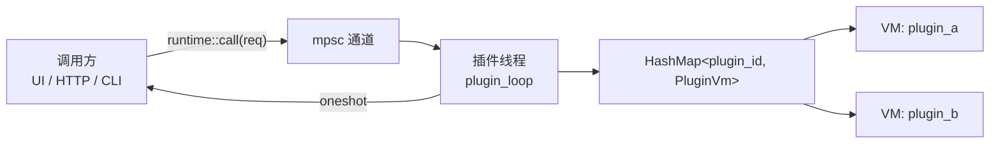

# oxidict-plugin

**`.potext` 插件运行时，基于 rquickjs（QuickJS）。**

> 内部结构、逐文件职责、不变量清单与设计决策 → [ARCHITECTURE.md](./ARCHITECTURE.md)

插件就是老格式的 `main.js` 脚本：宿主把源码作为**脚本** eval，入口函数
（`translate` / `recognize` / `tts` / `collection`）落在 `globalThis` 上，由宿主直接调用——
与原版 Tauri 宿主的 `eval(main.js)` 语义一致。

**关键性质：运行时不依赖窗口与渲染循环**，CLI / HTTP / UI 三种上下文行为一致。
（这是相对旧 gpui-shell 方案的本质区别——那时所有插件 View 挤在 GPUI 主线程上。）

## 依赖

```
oxidict-plugin  →  oxidict-core, oxidict-services, oxidict-net
被依赖：app
```

外部依赖：`rquickjs`（features: `futures`, `loader`）、`base64`（OCR 入参编码）、
`zip` + `walkdir`（`.potext` 解包）、`async-trait`、`serde_json`、`thiserror`。

## 模块

| 模块 | 职责 |
| --- | --- |
| `runtime.rs` | 专职插件线程、VM 生命周期（load / call / unload）、超时 |
| `host.rs` | 宿主能力面：`oxidict` 原生模块 + 全局对象 + legacy `utils` |
| `adapter.rs` | 把 JS 插件适配成四大服务 trait（`PluginService`） |
| `install.rs` | `.potext` 安装 / 卸载 / 列举 |

## 线程与 VM 模型



**为什么所有 VM 挤在一个线程**：rquickjs 的 `AsyncRuntime` 在默认（非 parallel）配置下是 `!Send`，
无法跨线程持有，因此所有 VM 固定在一个专职线程上；调用方通过 channel 提交请求、oneshot 回传结果。

- 目前请求在线程上**顺序处理**——与旧 gpui-shell 方案（所有插件 View 挤在 GPUI 主线程）**相同的串行度**。
  插件数量上来后可升级为 `LocalSet` + `spawn_local` 并行。
- 单次调用有 **30 秒超时**（`CALL_TIMEOUT`），避免插件挂死拖住翻译面板。
- 插件线程自己建了一个 current_thread tokio runtime（不走全局的那个）。

## 宿主能力面

三种注入方式并存，插件按习惯任选：

| 方式 | 用法 |
| --- | --- |
| ESM 原生模块 | `import { http_request, read_text_file, run, utils } from "oxidict"` |
| 全局对象 | `globalThis.oxidict.http_request(...)` |
| legacy `utils` | 挂在入口函数的 `options` 参数里传入 |

| 能力 | 说明 |
| --- | --- |
| `http_request(method, url, headers, body?)` | **宿主代发** HTTP（底层走 `oxidict-net`/wreq）——脚本自身**没有网络能力** |
| `read_text_file(path)` | 读文本文件，限定在插件目录内 |
| `run(cmd, args)` | 执行外部程序，限定在插件目录内 |
| `utils.{cacheDir, pluginDir, osType}` | 路径与平台信息 |
| `console.{log,info,warn,error}` | QuickJS 标准库没有 console，桥接到 `log` crate |

### 安全边界（改动这里前务必读）

- **路径校验用 `canonicalize` 而不是字符串 `starts_with`**。`root.join("../../etc/passwd")`
  在字符串上仍以 root 开头，但 `open` 时会沿 `..` 逃出目录。实现见 `canonical_within`，
  它同时覆盖符号链接逃逸；目标不存在时退化为「规范化父目录 + 文件名」，保证尚不存在的路径
  同样无法越界。
- **保留调用方指定的 HTTP 方法**。早期实现把非 POST 一律降级成 GET，会让插件的 `PUT`/`DELETE`
  静默变成 GET，而服务端往往仍返回 2xx，问题极难定位。

### 与 legacy（Tauri）宿主的差异

未实现：`utils.tauriFetch` / `utils.readBinaryFile` / `utils.CryptoJS`——用到它们的插件会得到
`undefined`，需要改写为 `oxidict.http_request` / `oxidict.read_text_file`。

## 插件调用协议

入口函数签名（老的脚本插件就是这个形状）：

```js
function translate(input, from, to, options) { /* 返回 string 或 dict 对象，也可返回 Promise */ }
function recognize(base64Image, lang, lang, options) { /* 返回 string */ }
function tts(text, lang, lang, options) { /* ... */ }
function collection(source, target, options) { /* ... */ }
```

`options` 对象含：

| 键 | 内容 |
| --- | --- |
| `config` | 该服务实例的配置（来自 `config.json`） |
| `detect` | 检测到的源语言 |
| `setResult` | 占位回调（早期流式接口遗留，当前为 no-op） |
| `utils` | legacy 能力对象 |

**返回值的解释**（`adapter.rs::translate`）：

- `string` / `null` → `TranslateResult::Plain`
- 对象 → 按词典结构解释 `{ pronunciations, explanations, associations, sentence }`，
  解析失败的分支退化为空列表（不报错）

同步函数与 async 函数都支持：返回值若是 Promise，宿主会 await 它。

## 安装与目录

`.potext` = `zip + info.json + main.js`。**装完不做任何改写**——运行时直接 eval 原始 `main.js`。

```
plugins/<kind>/<plugin_id>/main.js      # kind = translate | recognize | tts | collection
```

四道校验（缺一不可，早期漏掉任何一个都会出问题）：

| 校验 | 为什么 |
| --- | --- |
| 包内必须有 `main.js` | 没有就没东西可跑 |
| `info.id` 不得含 `/`、`\`、`..` | `plugin_id` 直接参与目标路径拼接，恶意 `{"id": "../../../.ssh"}` 能把文件写到插件目录之外 |
| `plugin_id` 必须以 `plugin` 开头 | 上游规则，加载侧也按这个前缀过滤 |
| **校验对象是最终落盘的目录名**（`info.id`，缺省取去掉 `.potext` 的文件名） | 早期实现只校验文件名、而加载侧按目录名过滤，导致 `info.id` 不以 `plugin` 开头的包**能装成功却永远不会被加载** |

`uninstall` 会同时调 `runtime::unload` 把 VM 从插件线程的 map 里摘掉。

## 公开 API

```rust
// 安装 / 卸载 / 列举
oxidict_plugin::install::install(&potext_path, ServiceKind::Translate, &store) -> Result<String>
oxidict_plugin::install::uninstall(plugin_id, kind, &store) -> Result<()>
oxidict_plugin::install::installed(kind, &store) -> Vec<String>

// 启动时加载全部已安装插件（app 启动第 2.5 步），返回成功加载的 id 列表
oxidict_plugin::load_installed(&store) -> Vec<String>

// 运行时（一般不用直接调，服务 trait 已封装）
oxidict_plugin::runtime::{load, unload, call, CallRequest}
```

> `runtime::load` 内部用 `Handle::block_on` 等待专职插件线程，**不能在 tokio 工作线程或
> `block_on` 内部调用**（会在独立线程上 panic）。调用点须在独立线程上——`app` 启动流程符合。

## 测试

```bash
cargo test -p oxidict-plugin
```

`tests/runtime.rs` 覆盖 VM 加载与调用链路（含 async 入口函数）；安装校验的边界
（路径穿越、前缀规则、缺 `main.js`）建议补充用例——这三条都是历史事故点。
