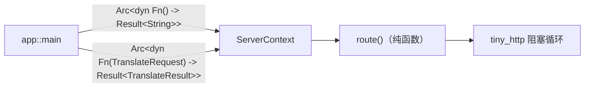
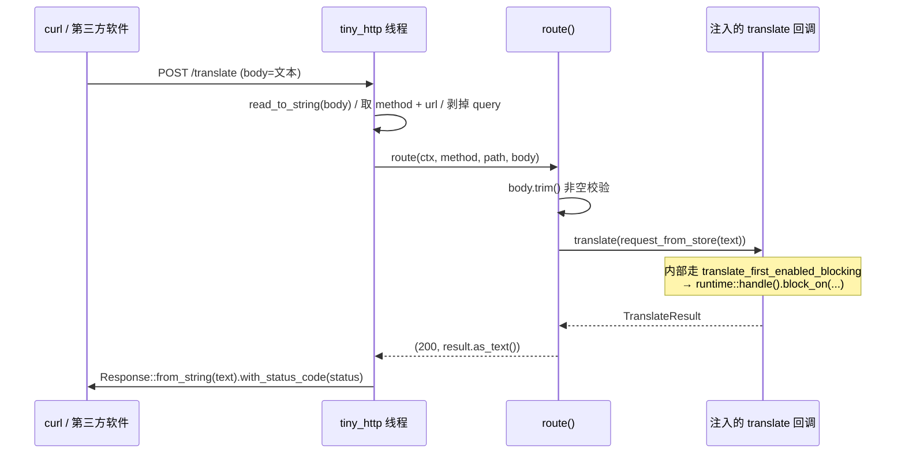

# oxidict-server 架构

> 面向维护者。使用者入口见 [README.md](./README.md)。整个 crate 只有一个 190 行的文件。

## 1. 定位

本机外部调用接口，路由与原版 `src-tauri/src/server.rs` 逐条对齐，第三方软件可用 curl 触发翻译。

**设计原则：这个 crate 只做 HTTP 协议层。** 它不依赖 `oxidict-services` / `oxidict-platform`，
服务选择、历史写入、取词都由调用方通过两个 `Arc<dyn Fn>` 注入。

## 2. 内部结构

| 项 | 行数 | 职责 |
| --- | --- | --- |
| `ServerContext` | ~30 | 两个注入回调：`selected_text`（取词）、`translate`（翻译） |
| `start(port, ctx)` | ~28 | 绑定 `127.0.0.1:port`，spawn 独立线程跑阻塞循环 |
| `route(ctx, method, path, body)` | ~30 | **纯函数**，返回 `(u16, String)`——可脱离网络单测 |
| `request_from_store(text)` | ~4 | 按当前配置组装请求（语言取 `translate_source_language` / `translate_target_language`） |
| `start_from_config(ctx)` | ~3 | 读 `server_port` 后调 `start` |
| `tests` | ~76 | 打表验证 `route` |

## 3. 为什么用注入回调

三个直接收益：

1. **可单测**：`route` 拿假回调就能打表验证全部路径与状态码，不用真监听端口。
2. **零重复实现**：`app` 注入的回调就是 CLI 用的 `translate_once`——「读启用列表 → 取首个实例 →
   resolve → translate → 写历史」全进程只有一份实现。
3. **不拉依赖**：本 crate 不依赖 services/platform，编译快、依赖面小。

## 4. 请求处理链路

**为什么必须跑在独立 `std::thread` 上**：翻译回调内部是 `block_on`，
若在 tokio 工作线程上调用会 panic。tiny_http 的阻塞循环天然运行在普通线程上，
两者正好匹配。

**URL 里的 query 被剥掉**（`url.split('?').next()`）：老版本的调用方会带 `?` 参数，
路由表按裸路径匹配。

## 5. 路由表与错误约定

| 方法 + 路径 | 状态码 | 说明 |
| --- | --- | --- |
| `GET /ping` | 200 `ok` | 健康检查，供外部脚本探测服务是否存活 |
| `POST /` · `POST /translate` | 200 / **500** | body 即待译文本；空 body 直接报错 |
| `GET /selection_translate` | 200 / **500** | 文本来自 `selected_text` 回调，不读 body |
| `GET /config` · `/input_translate` · `/ocr_recognize` · `/ocr_translate` | **501** | 依赖图形界面的窗口端点 |
| 其它 | 404 `not found` | — |

两条刻意的行为：

- **窗口端点返回 501 而不是假装成功**：这些端点要打开/驱动窗口，在就绪前明确告知「未实现」
  比返回空洞的 200 更好排查。
- **回调错误统一映射为 500**（`Err(e) => (500, e.to_string())`）：错误文本直接回给调用方，
  第三方软件能看到「翻译服务列表为空」这类可操作的原因。

## 6. 不变量与契约

| # | 不变量 | 违反后果 | 测试 |
| --- | --- | --- | --- |
| 1 | 监听失败只记警告，不阻塞主程序 | 老版本 Tauri 应用占用 60606 时新版本打不开 | app 侧 `log::warn!` 后继续 |
| 2 | `route` 是纯函数（只依赖 ctx 与入参） | 无法脱离网络测试 | ✅ `route_dispatches_paths_and_status_codes` |
| 3 | 空 body 必须报错 | 拿空串跑一次真实翻译 | ✅ 断言 `is_err()` |
| 4 | 窗口端点返回 501 | 假成功误导调用方 | ✅ 4 个路径逐个断言 |
| 5 | 绑定 `127.0.0.1` 而非 `0.0.0.0` | 服务暴露到局域网 | 代码 |
| 6 | query 被剥掉后再路由 | 带参数的调用方全部 404 | 代码 |

## 7. 已知限制

- **窗口端点未实现**（501）。要接通需把「打开某窗口」也做成注入回调（依赖 GPUI 的 `App`），
  本 crate 不愿引入 gpui 依赖——**接通点会落在 `app` 或 ui 层**，而不是在这里加依赖。
- **无鉴权**：任何本机进程都能调用。这是原版行为（监听回环地址），
  但意味着**不能把 `server_port` 配到对外地址**。
- **无并发限制**：tiny_http 的顺序循环，一次只处理一个请求。翻译是 IO 密集且由 tokio 池执行，
  实测够用；要并发需换线程池或异步 server。
- **只有 1 个测试**，但它是打表式的、覆盖了全部路径与状态码分支，性价比高。

## 8. 扩展点

| 想加什么 | 改哪里 | 注意 |
| --- | --- | --- |
| 新端点 | `route()` 的 match + `tests` 里加断言 | 保持 `route` 纯函数 |
| 接通窗口类端点 | 需要新增注入回调（`Arc<dyn Fn(...)>`），实现放在 `app`/ui 层 | **不要**在这里依赖 gpui |
| 改端口 | `config::keys::SERVER_PORT`（默认 60606） | 老调用方硬编码了 60606，改默认值等于破坏兼容 |
