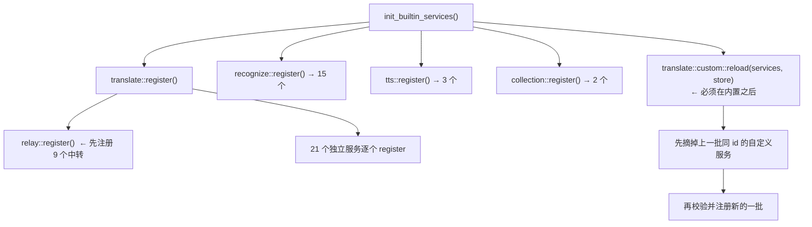

# oxidict-services 架构

> 面向维护者。使用者入口见 [README.md](./README.md)。

## 1. 定位

服务抽象层 + 全部内置实现。**7,752 行**，是本工程最大的 crate。

核心设计是把原实现的「一组 JS 模块 + 命名空间聚合」换成 **trait + 注册表**，由此得到三个性质：

1. 内置实现与 `.potext` 插件**对调用方不可区分**（都是 `Arc<dyn Translator>`）。
2. `config_schema()` 让设置面板统一渲染表单 → 30 份手写 `Config.jsx` 归一。
3. 服务可脱离 UI 单测（虽然当前测试主要集中在 spec 解析与表驱动部分）。

## 2. 文件职责

### 2.1 顶层

| 文件 | 行数 | 职责 |
| --- | --- | --- |
| `lib.rs` | 410 | 四个 trait、`Services` 注册表、`TLS_KEY`/`tls_field`、面向 UI 的异步入口与 `spawn_*` |
| `translate/mod.rs` | 58 | 声明 21 个独立服务 + `register()` |
| `recognize/mod.rs` | 38 | 声明 15 个服务 + `register()` |
| `tts/mod.rs` | 12 | 声明 3 个服务 + `register()` |
| `collection/mod.rs` | 10 | 声明 2 个服务 + `register()` |

### 2.2 translate 的三个特殊文件（不是普通服务）

| 文件 | 行数 | 角色 |
| --- | --- | --- |
| `relay.rs` | 346 | 9 个 LLM 中转的**声明式表** + 执行器（`RELAYS` / `RelaySpec` / `BodyShape` / `FieldShape`） |
| `custom.rs` | **1640** | 配置驱动的自定义服务（解析 / 校验 / 表单 / 占位符 / 签名 / 会话 / 流式） |
| `openai_compatible.rs` | 200 | OpenAI 协议共享层，被 `openai` / `ollama` / `geminipro` 复用；**`pub(crate)`**，不是可注册服务 |
| `lang_names.rs` | 71 | 内部语言码 → 英文名（`{{from}}`/`{{to}}` 占位符用） |

### 2.3 其余服务文件

每个 40–280 行，形态统一：一个零大小结构体 + `impl Translator`（或对应 trait）。
最大的几个是 HTML 提取类型的（`cambridge_dict.rs` 274 行、`bing_dict.rs` 172 行、
`tencent_img.rs` 164 行）。

## 3. 注册表与实例解析



**顺序是有语义的**：自定义服务在内置之后注册，这样「与内置同名」能被检出并跳过，
而不是让一条自定义 spec 悄悄顶掉内置实现。

**`reload` 必须先摘后注册**：否则删除或改名一条 spec 后，旧实现会留在注册表里直到重启，
表现成「删了还在」。这就是 `Services::remove_translator` 存在的原因。

### 实例 key 的两段式

```
config.translate_service_list = ["google", "alibaba@r4nd0m"]
                                            └─┬─┘ └──┬──┘
                                         服务名    实例备注
```

- `parse_instance("alibaba@r4nd0m")` → `("alibaba", Some("r4nd0m"))`
- 实例备注的作用：**同一服务的多份配置**（例如两个不同 Key 的 DeepL）。
- 实例在 `config.json` 里是**顶层键**，值即该实例的配置对象：`"alibaba@r4nd0m": { ... }`。
- 服务名不能含 `@`（它同时是分隔符）。

`resolve_*` 家族做「实例 key → (服务实现, 该实例的配置)」的解析，是 UI 层唯一需要的入口。

## 4. 自定义服务（`custom.rs`，1640 行）

这是全 crate 最复杂也最容易踩坑的部分，单列一节。

### 4.1 类型结构

```
CustomServiceSpec
├── id / label / endpoint / method
├── auth: AuthSpec            # 具名变换器：none | bearer | header{name}
│                             #              | query{name} | hash_query{algo,name,template,extra}
├── headers: Map<String, Value>
├── body: Option<Value>       # 省略则不发送请求体（GET 常用）
├── extract: ExtractSpec      # text（JSON 路径）或 html_selector（CSS 选择器），二选一
│                             # + stream_mode / stream_delta
├── session: Option<SessionSpec>   # {url, method, token_path} 多步会话前置请求
├── fields: Vec<FieldSpec>    # 声明式表单（text/secret/select/switch/number）
└── tls: String               # 指纹档位
```

### 4.2 占位符求值是核心机制

```
render(template: &Value, ctx) -> Value     # 递归处理对象/数组
  └── substitute(s, ctx)                   # 字符串级替换
        └── whole_placeholder(s)           # 整串就是一个 {{name}} 时返回名字
```

可用的占位符：`{{text}}`、`{{from}}`/`{{to}}`（英文语言名）、`{{fromCode}}`/`{{toCode}}`
（内部语言码）、`{{apiKey}}`、`{{salt}}`（每次请求一个 UUID）、`{{timestamp}}`（Unix 秒）、
`{{token}}`（会话前置请求取回的值），以及**任意配置字段名**。

**两条必须保持的行为**：

1. **整串为占位符且字段是数字/布尔时保留 JSON 类型**（`whole_placeholder` 分支）。
   否则 `"temperature": "{{temperature}}"` 会传成字符串 `"0.7"`，服务端报类型错误。
2. **`{{salt}}` 与 `{{timestamp}}` 在一次求值内只生成一次**。
   这是签名能对上的前提——模板里可能引用多次，每次重新生成就会对不上。
   ✅ 有测试 `salt_and_timestamp_are_stable_within_one_evaluation` 把守。

### 4.3 JSON 路径解析

`path_to_pointer("data.items[0].text")` → JSON Pointer。支持点号、方括号下标、以及**转义**。
✅ 测试 `path_to_pointer_handles_dots_brackets_and_escapes`。

### 4.4 签名（`hash_query`）

```
hash_query_params(...)  # 明文模板拼接 → 哈希 → 结果作为查询参数发出
```

- 支持 `md5` / `sha256`（`hmac_sha256` 时把某个配置字段当 key，见
  `hash_query_hmac_uses_config_field_as_key`）。
- ✅ 有测试 `hash_query_matches_independent_vectors`（由 Python 独立算出向量）。
- **签名类鉴权不能在设置面板的表单里编辑**，只能写 `config.json`：
  表单若照原样保存会把签名配置丢掉，那比不能编辑更糟。

### 4.5 校验与失败策略

| 场景 | 行为 |
| --- | --- |
| 单条 spec 不合法 | **只跳过并在日志里指出下标**（`custom_services[2]（id="x"）已跳过: ...`），不让应用起不来 |
| 与内置服务同名 | 跳过（避免悄悄顶掉内置实现） |
| 设置面板保存 | `apply()` **先校验全部条目再落盘**——半途失败会让配置处于「已写入但未生效」的中间态，比直接拒绝更难排查 |
| 鉴权下拉下标越界 | `auth_kind_at` 回退 `none`。回退到「无鉴权」而不是别的：宁可请求少带一个头（服务端会明确报鉴权失败），也不要把密钥塞进用户没选择的字段里 |

### 4.6 `intern`：刻意的字符串驻留

`ConfigField` 的 `key` / `label` 类型是 `&'static str`，而自定义服务的这些字符串**来自配置文件**
（运行期才知道）。解法是 `intern()`：按值去重后 `Box::leak`。

- `intern` **按值去重**，所以重复注册不会累积字符串。
- `intern_options` 每次调用泄漏一个很小的 `Vec`（选项数量级）。设计注释里已声明：
  注册在进程启动时执行一次，量级可忽略；**但设置面板每次保存自定义服务都会重跑一遍注册**，
  所以这块会随保存次数缓慢增长。当前规模下无实际影响，若要支持频繁热重载需改为按 spec 缓存。

## 5. 并发模型

```
UI（GPUI 执行器）
  └── spawn_translate(instance, req) ──→ 全局 tokio runtime
                                          └── translate_instance()
                                                └── services().resolve_translator()
                                                └── svc.translate(req).await
  └── .await JoinHandle   ← JoinHandle 不依赖 tokio 线程局部，可跨执行器等待
```

- 注册表用 `RwLock<HashMap>`（`parking_lot`）：读多写极少（只在启动与自定义服务保存时写）。
- `SERVICES: OnceCell<Services>` 惰性初始化。
- `translate_first_enabled_blocking` 供**非 async 上下文**（CLI、tiny_http 工作线程）使用，
  内部 `runtime::handle().block_on`。**调用点必须在独立 `std::thread` 上**，
  否则在 tokio runtime 上下文里会 panic。

## 6. 不变量与契约

| # | 不变量 | 违反后果 | 测试 |
| --- | --- | --- | --- |
| 1 | 自定义服务在**内置之后**注册 | 自定义 spec 悄悄顶掉内置实现 | — |
| 2 | `reload` 先摘后注册 | 删/改名后「删了还在」直到重启 | — |
| 3 | 中转服务 id 不可改动 | id 写进用户的 `config.json`，改了老配置全失效 | ✅ `service_ids_are_pinned` |
| 4 | 中转服务 id 唯一 | 后注册的静默覆盖前一个 | ✅ `service_ids_are_unique` |
| 5 | 中转服务 `default_model` 必须在 `models` 里 | 下拉框选不中默认值 | ✅ `default_model_is_selectable` |
| 6 | `{{salt}}`/`{{timestamp}}` 一次求值只生成一次 | 签名对不上 | ✅ `salt_and_timestamp_are_stable_within_one_evaluation` |
| 7 | 整串占位符保留 JSON 类型 | 数字/布尔被传成字符串，服务端类型报错 | ✅ `render_keeps_json_type_for_whole_placeholder` |
| 8 | `apply` 先全量校验再落盘 | 配置「已写入但未生效」的中间态 | ✅ `form_rejects_bad_input` |
| 9 | 签名类鉴权不在表单里编辑 | 表单保存会丢签名配置 | 表单只映射 `FormValues` 子集 |
| 10 | 实例名不含 `@` | 实例解析错位 | — |
| 11 | `tls` 下拉而非自由文本 | 拼错静默回退 `native`，用户以为设置没生效 | `TLS_OPTIONS` 是封闭表 |
| 12 | 表单覆盖的是「纯映射服务」子集 | 把 `headers`/`fields`/会话/流式塞进表单会让界面复杂度暴涨 | 设计决策，非缺陷 |

## 7. 测试分布

本 crate **24 个测试**，全部集中在不需要网络的部分：

| 文件 | 数量 | 覆盖 |
| --- | --- | --- |
| `translate/custom.rs` | 19 | 占位符渲染（嵌套/类型保留/未知与未闭合）、路径解析、JSON 提取、spec 校验、表单往返与拒绝、鉴权下标映射、`hash_query`（独立向量 / 会话 token / 校验）、HTML 选择器提取、会话 URL 校验 |
| `translate/relay.rs` | 3 | id 固定、id 唯一、默认模型可选 |
| `translate/lang_names.rs` | 2 | 语言英文名映射、回退不为空 |
| 其余 50 个服务文件 | **0** | — |

**最大的测试空白**：50 个具体服务实现（30 翻译 + 15 OCR + 3 TTS + 2 生词本）**没有一个单测**。
它们的请求构造与响应解析（尤其是 HTML 提取型服务）是纯函数可以覆盖的部分，
但这些服务大多需要凭据或真实端点，历史上靠端到端手工验证。

## 8. 已知限制

- **50 个服务无单测**（见上）。
- **`intern_options` 每次注册泄漏一个小 `Vec`**（见 §4.6），量级可忽略但非零。
- **`translate_first_enabled_blocking` 有线程上下文约束**（不能从 tokio 上下文调用）。
- **流式只支持 SSE**（`stream_mode: sse_json`）；其它流式协议走插件。
- **`{{fromCode}}`/`{{toCode}}` 是内部码**（`zh_cn` 这种下划线形式），不是 BCP-47；
  没有自定义语言映射（这是刻意的能力边界）。

## 9. 扩展点

| 想加什么 | 改哪里 | 代价 |
| --- | --- | --- |
| 纯映射型翻译服务 | `config.json` 的 `custom_services`，或设置页「自定义服务」 | 零代码 |
| LLM 中转服务 | `relay.rs::RELAYS` 加一行 | 一行 |
| 独立翻译服务 | `translate/<name>.rs` + `translate/mod.rs` 的 `pub mod` 与 `register()` | 两处 |
| OCR / TTS / 生词本服务 | 对应目录新增文件 + `mod.rs` 的 `register()` | 两处 |
| 需要多步/条件/循环逻辑 | `.potext` 插件 | 不在此 crate |
| 新表单字段类型 | `oxidict-core::schema::ConfigField` + `oxidict-ui/config_window/services.rs` | 两处（跨 crate，必须同步） |
