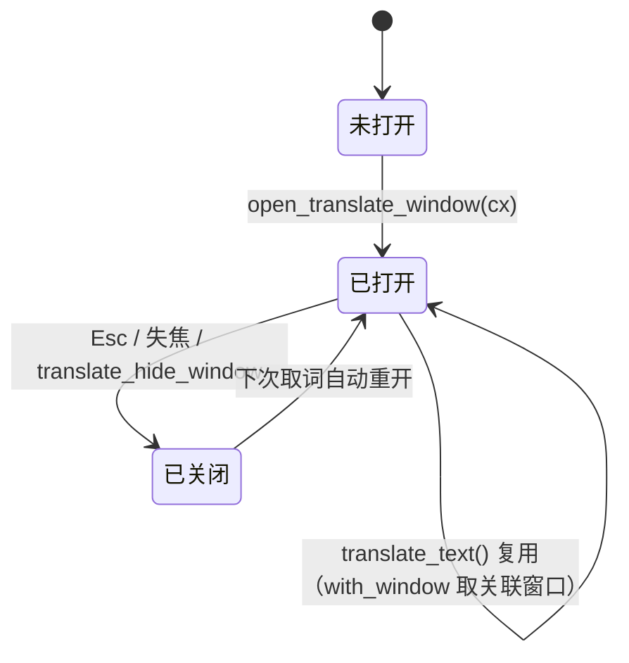
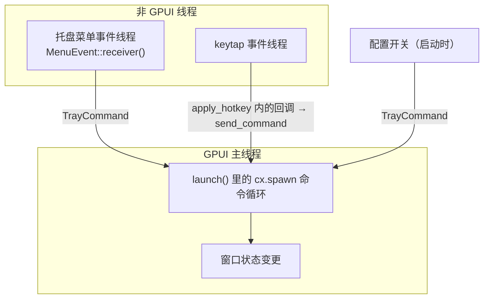
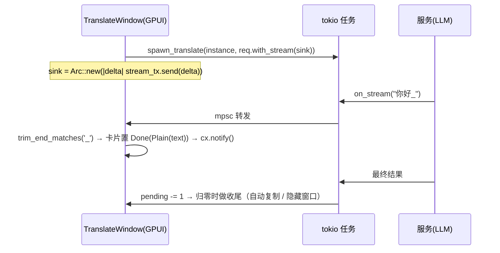

# oxidict-ui 架构

> 面向维护者。使用者入口见 [README.md](./README.md)。

## 1. 定位

GPUI 窗口层，本工程第二大 crate（**6,219 行 / 14 文件**）。

职责边界：**只做渲染与交互编排**。服务选择、历史写入、平台调用都在
`services` / `platform` / `app` 里。后果是 `cargo test` 能在无窗口环境覆盖大部分逻辑，
CLI 与 HTTP 入口复用同一份实现。

依赖方向：`oxidict-ui → oxidict-services + oxidict-net + oxidict-platform + oxidict-core`。
**没有任何 crate 依赖它**（只有 `app`）——窗口层是终端消费者。

## 2. 文件职责

### 2.1 基础设施（4 个文件）

| 文件 | 行数 | 职责 |
| --- | --- | --- |
| `lib.rs` | 336 | 窗口创建与全局句柄、主题应用、`TrayCommand` 消费循环、光标跟随定位 |
| `tray.rs` | 416 | 托盘图标与菜单、菜单事件线程 → `TrayCommand`、剪切板监听开关、自动复制单选组 |
| `hotkey.rs` | 403 | 快捷键**录制**组件（按键 → `Ctrl+Alt+T` 字符串）+ `apply_hotkey` 生效入口 |
| `tokens.rs` | 141 | 排版标尺（具名档位）+ 字体配置注入 |
| `logos.rs` | 457 | 品牌 logo 资产源（编译期嵌入）+ 服务 id → logo uri 映射 |

### 2.2 窗口（6 个 + 设置窗口 3 文件）

| 文件 | 行数 | 窗口 |
| --- | --- | --- |
| `translate_window.rs` | 627 | 主翻译窗口（多实例卡片 + 流式 + 动态翻译） |
| `config_window/mod.rs` | 759 | 设置窗口：侧栏 + 页路由 + **全部表单状态** |
| `config_window/pages.rs` | 1465 | 快捷键 / 通用 / 备份 / 历史页（**单文件最大**） |
| `config_window/services.rs` | 744 | 服务实例管理：实例列表增删移 + schema 驱动表单渲染 |
| `recognize.rs` | 301 | OCR 窗口（图片区 + 结果区） |
| `updater.rs` | 246 | 更新窗口（GitHub release 检查） |
| `input_translate.rs` | 215 | 输入翻译独立小窗（320×180） |
| `notify.rs` | 109 | 通知窗（3 秒自动关闭）——**最薄的一个，新窗口照它抄** |

## 3. 窗口生命周期

### 3.1 翻译窗口的复用语义



`TranslateWindowHandle` 是 GPUI Global（`impl Global`），存**弱引用 + 窗口句柄**：

- `view: WeakEntity<TranslateWindow>` → 判断是否还能复用（`upgrade().is_none()` 即已关闭）
- `window: Option<WindowHandle<Root>>` → 供翻译完成后 `hide_window` 等窗口级操作

`translate_text()` 的复用路径有个细节：`Entity::update` 不提供 `Window`，
所以用 `cx.with_window(entity_id, |window, cx| ...)` 取到该实体当前关联的窗口。
取不到就记 warn——说明实体存在但窗口已消失。

### 3.2 每个窗口开窗时都要做的三件事

| 步骤 | 调用 | 漏掉的后果 |
| --- | --- | --- |
| 恢复主题 | `apply_saved_theme(window, cx)` | `gpui_component::init` 会把主题强制设成 Light，用户保存的 `app_theme` 被静默忽略，默认值 `"system"` 永不生效 |
| 应用字体配置 | `tokens::apply_font_config(...)`（由 `apply_saved_theme` 一并调用） | `app_font` / `app_font_size` 变回死键 |
| 设窗口背景 | `window_background_appearance()` + `window_root_bg()` | 「窗口毛玻璃」设置在部分窗口上完全无效（早期只有透明标题栏，观感割裂） |

**主题与字体必须一起应用**：两边各调一次 `Theme::change` 会互相覆盖。

## 4. 命令桥：托盘/快捷键 → GPUI



**统一通道的意义**：热键、托盘菜单、配置开关都只负责「发命令」，真正的状态变更在 GPUI 命令循环里
执行，保证所有 GUI 状态变更都落在 GPUI 执行器上。

| 设计点 | 理由 |
| --- | --- |
| `COMMAND_TX: OnceLock<UnboundedSender<TrayCommand>>` | 全局发送端，供快捷键录制等非托盘模块复用。`UnboundedSender` 是 `Clone + Send + Sync` |
| `send_command()` 返回 `bool` | `false` 表示托盘未安装（CLI 模式）或循环已退出 |
| **命令循环不写兜底分支** | `TrayCommand` 一旦新增变体，`match` 直接编译失败，强迫显式决定处理方式，而不是默默落进日志 |
| `tray::install` 必须在主线程、`gpui_kit::init` 之后 | `tray-icon` 在 macOS 上必须在主线程创建 |
| `TRAY_STATE: OnceLock<AtomicPtr<TrayState>>` | `CheckMenuItem` **不是 `Send`/`Sync`**（内部持有平台原生菜单对象），不能进普通 `static`/`Mutex`。它只在主线程被访问（创建与切换都在 GPUI 主线程），故用裸指针常驻 |

> **`AtomicPtr` 那条是本 crate 唯一的 unsafe 邻域**：其正确性完全依赖「只在主线程访问」
> 这条不变量。改动托盘状态访问路径时，务必确认仍在 GPUI 主线程回调内。

## 5. 翻译窗口：并发与流式

### 5.1 多实例并行

启用列表里的**每个实例**并发跑一个 `spawn_translate`，各自对应一张结果卡片。
卡片状态：`Idle` / `Loading` / `Done(TranslateResult)` / `Failed(String)`。

### 5.2 两个计数器（都是为修 bug 而生）

```
run_generation: u64     # 本轮翻译的代号，每次 run_translate +1
pending: usize          # 本轮仍在进行中的实例数
```

| 字段 | 解决的问题 |
| --- | --- |
| `run_generation` | 连按两次「翻译」时，上一轮的迟到回调会覆盖新结果。代次不匹配即丢弃 |
| `pending` | **不能用「有没有卡片处于 Loading」判断全部完成**——流式回调会把卡片提前置为 `Done`，导致其它实例还在翻译时就误判为完成，进而**提前自动复制并关闭窗口** |

`dynamic_translate` 另有一个防抖代次 `dynamic_generation`（`Cell<u64>`）：
每次文本变化 +1，延迟后比较代次决定是否真的发起翻译。

### 5.3 流式增量上屏



流式回调在 **tokio 线程**上执行，用 `mpsc` channel 转回 GPUI 更新卡片——
不能在回调里直接碰 GPUI 状态。

### 5.4 `run_translate` 里的配置分支

按顺序处理，每一步都对应一个配置键：

| 顺序 | 开关 | 行为 |
| --- | --- | --- |
| 1 | `translate_remember_language` | 开关时才把语言选择写回 config |
| 2 | `translate_delete_newline` | 非 0 时把 `\n` 替换成空格 |
| 3 | `translate_detect_engine = "local"` | 源语言为 auto 时先本地检测，把**具体语言**传给服务（UI 下拉仍显示「自动检测」，与原版一致） |
| 4 | `translate_second_language` | 源语 == 目标语时（无法翻译自己）自动改用第二目标语，避免服务报「相同语言」错误 |
| 5 | `incremental_translate` | 新文本**追加**而非替换（对齐原版 `SourceArea::handleNewText`），用 `replace_all` 保留撤销栈 |

## 6. 设置窗口

### 6.1 页结构

9 个导航项（`NAV_ITEMS`，图标 + i18n key）：

```
0..=3  翻译 / 识别 / TTS / 生词本   ← 由 config_window/services.rs 渲染，共用一套实例管理
4      快捷键        ┐
5      通用          │
6      备份          ├ pages.rs
7      历史          │
8      自定义服务    ┘
```

`nav_kind(ix)` 把 0..4 映射到 `ServiceKind`——四个服务分类页**共用同一实现**
（`render_service_page`），这是原版 30 份手写 `Config.jsx` 归一后的产物。

### 6.2 表单状态的存放方式

`ConfigWindow` 的字段就是**全部表单状态**（30+ 个 `Entity<InputState>` /
`Entity<SelectState<...>>` / `bool`）。没有任何中间层——表单值直接对应配置键，
保存时逐个 `store.set`。

### 6.3 两个刻意的交互设计

| 设计 | 理由 |
| --- | --- |
| `PendingRestore` 枚举（`Remote(name)` / `Local`） | 恢复会**整份替换**本地 `config.json` 与 `history.db`，属破坏性操作。必须先让用户看清「将恢复哪一份」再确认，**不能静默取最后一个** |
| 签名类鉴权（`hash_query`）不可在表单编辑 | 表单只映射 `FormValues` 子集；照原样保存会把签名配置丢掉，那比不能编辑更糟 |
| `saved_hint` | 保存后给一次视觉反馈 |

## 7. 排版与字体（`tokens.rs`）

```
Text 档位（未缩放 px）
  Xs 10 · Sm 11 · Body 12 · Label 13 · Heading 14 · Logo 16

scale() = clamp(app_font_size / 16, 0.75, 1.6)
```

- **默认零视觉变化**：`app_font_size = 16` 时缩放系数恰为 1，档位值就是改造前手写的像素值
  （12px 是「说明与数据」、13px 是「设置项标签」，这套分工原本自洽，只是没有名字）。
- **夹在 `[0.75, 1.6]`** 是防手改配置把布局撑爆——本工程大量使用固定像素内边距。
- **为什么注入 `ThemeConfig` 而不是直接改 `Theme.font_family` / `font_size`**：
  后者会被下一次 `Theme::change` 用 light/dark 配置覆盖回去（见 gpui-component
  `theme/schema.rs::apply_config`）。
- **「跟随系统」在窗口重新激活时按当前系统外观重算**——gpui 没有外观变化回调，
  这是不加轮询的可行做法（系统里切深浅色后切回应用即生效）。

## 8. 三个 GPUI 特有的坑（都写在代码注释里）

### 8.1 Esc 关窗必须用元素级 `on_key_down`

**不能用 `window.on_key_event`**：那个方法只能在 paint 阶段调用（`debug_assert_paint`），
而 `View::render` 运行在 **layout** 阶段——在 render 里调用它会在启动时 panic
（release 构建下表现为 key_dispatch 的 `active_node()` unwrap，因为断言被编译掉了）。

元素级 `on_key_down` 在 paint 阶段注册，是正规途径；且它在 action 绑定派发**之前**收到原始按键，
不会被输入框自己的 `escape → Escape` 绑定抢走。见 `escape_listener()`。

### 8.2 光标坐标的域差异

`mouse_follow_origin()`：mouse_position 与 DisplayInfo **同为系统全局坐标**，但：

| 平台 | 单位 | 处理 |
| --- | --- | --- |
| macOS | points（与 gpui 逻辑坐标**同域**） | 直接用 |
| Windows / Linux | 物理像素 | 除以 `scale_factor` |

超出光标所在屏幕右/下边缘时反向偏移一个窗口宽/高，再夹回屏幕内（对齐原版 tauri `window.rs`
的 mouse 分支）。近似换算，边缘 clamp 偶有细微偏差，实机验证后校准。

### 8.3 Dock 策略的时序约束

`dock::apply_from_config()` 必须在 GPUI `.run(cx)` 回调内调用（不能在之前）——
原因见 `oxidict-platform` 的 `ARCHITECTURE.md` §5.2（启动即 panic 的历史事故）。

## 9. 资产与 logo（`logos.rs`）

```rust
CombinedAssets                      // 组合资产源
  ├── path 以 "logo/" 开头 → 从编译期嵌入的 LOGO_FILES 里取（Cow::Borrowed）
  └── 其余 → 回退 gpui_kit::assets::Assets（图标字体等）

logo_uri(service_id) -> Option<&'static str>
  ├── "system" → None（用系统图标）
  ├── 查 SPECIAL 显式表（文件名与服务 id 不一致的）
  └── 回退 {id}.svg → {id}.png
```

logo 在编译期通过 `include_bytes!` 嵌入二进制，无运行时文件依赖。
`service_id` 与文件名的映射由 **8 个测试**把守（嵌入文件非空、SPECIAL 指向存在的文件、
system 无 logo、stem 默认映射、png 回退、SPECIAL 覆盖、未知服务返回 None、全部已知名可解析）——
这是本 crate 测试最密的地方，因为**漏一个 logo 只会在界面上显示空白，不会报错**。

## 10. 不变量与契约

| # | 不变量 | 违反后果 | 把守 |
| --- | --- | --- | --- |
| 1 | 主题与字体必须一起应用（同一次 `Theme::change`） | 互相覆盖，`app_theme` 或字号失效 | `apply_saved_theme` 统一入口 |
| 2 | Esc 用元素级 `on_key_down` | 在 render 里调 `window.on_key_event` 会 panic | `escape_listener()` |
| 3 | 所有 GUI 状态变更在 GPUI 执行器上 | 竞态 / panic | 命令循环是唯一变更点 |
| 4 | `TrayState` 只在主线程访问 | `CheckMenuItem` 非 Send/Sync，跨线程访问是 UB | 代码约定（`AtomicPtr` 无运行时保护） |
| 5 | 完成判定用 `pending` 而非卡片状态 | 流式回调提前置 Done → 提前自动复制并关窗 | `pending` 字段 |
| 6 | 迟到结果按 `run_generation` 丢弃 | 旧结果覆盖新结果 | 代次比较 |
| 7 | `tray::install` 在主线程 + `gpui_kit::init` 之后 | macOS 上托盘创建失败 | 调用点约定 |
| 8 | `dock::apply_from_config` 在 `.run()` 回调内 | 启动即 panic | 调用点约定 |
| 9 | 破坏性恢复需显式确认（`PendingRestore`） | 静默覆盖用户配置与历史 | 类型设计 |
| 10 | `logo_uri("system")` 返回 `None` | 系统服务显示空白 logo | ✅ `system_service_has_no_logo` |
| 11 | `Text` 档位未缩放值对齐改造前像素 | 界面视觉回归 | ✅ `steps_are_ordered_and_match_legacy_pixels` |
| 12 | 缩放夹在 `[0.75, 1.6]` | 手改配置把布局撑爆 | ✅ `scale_is_unity_at_default_base_and_clamped` |

## 11. 测试分布

本 crate **17 个测试**：

| 文件 | 数量 | 覆盖 |
| --- | --- | --- |
| `logos.rs` | 8 | logo 嵌入与 id 映射（见 §9） |
| `hotkey.rs` | 6 | 必须有修饰键、修饰键组合、特殊键与 F 键、拒绝未知/越界、标点与数字键盘、清空键检测 |
| `tokens.rs` | 2 | 档位顺序与像素值、缩放系数 |
| `config_window/mod.rs` | 1 | 字号配置值 → 下拉下标 |

**空白点**：`translate_window.rs` 的 `run_generation` / `pending` / 防抖代次这类状态机
没有测试（提取成纯函数即可覆盖）；`tray.rs` 的 `AutoCopyMode::from_config` 映射也没有。

## 12. 已知限制

- **OCR 窗口的图片区未接入渲染**：当前用占位框 + 文件大小文本代替。
  gpui 侧 `img()` 可用，**缺的是把截图字节转成 `ImageSource` 的接入**——这是最明确的待补点。
- **通知窗 3 秒自动关闭**是硬编码时长，未做配置。
- **识别结果回填翻译未实现**（结果区可复制，但没有「送去翻译」按钮）。
- **历史页无真正分页**：`HISTORY_PAGE = 100` 是「加载更多」的步长，不是分页。
- **`TrayState` 依赖主线程约定，无编译期保障**（见 §4）。
- **改语言不会更新已开窗口的标题栏**（标题在创建时 `t()` 取一次）。
- **`app_fallback_font` 未接入**：gpui 主题只暴露单一 `font_family`，没有候选列表。

## 13. 扩展点

| 想加什么 | 改哪里 | 参考 |
| --- | --- | --- |
| 新窗口 | `src/` 新建模块，照 `notify.rs`（109 行，最薄）抄 | 记得做 §3.2 的三件事 |
| 新设置页 | `config_window/pages.rs` 加渲染函数 + `mod.rs` 的 `NAV_ITEMS` 与 `match self.nav` | 两处都要改 |
| 新托盘菜单项 | `tray.rs::install` 的菜单构造 + `TrayCommand` 加变体 + **命令循环加分支**（编译器会强制） | 三处 |
| 新快捷键 | `config::keys` 加键 + `app/src/main.rs` 的注册循环 + 设置页快捷键盘位 | 三处 |
| 新 logo | `crates/oxidict-ui/assets/logos/<id>.svg` + `logos.rs::LOGO_FILES` 列表 + 必要时 `SPECIAL` | 跑 logos 的 8 个测试 |
| 新排版档位 | `tokens.rs::Text` 加变体 + `base()` | 默认值必须对齐改造前像素 |
| 接入 OCR 窗口图片渲染 | `recognize.rs` 的图片区 | 缺口明确，需把 `Vec<u8>` 转 `ImageSource` |
