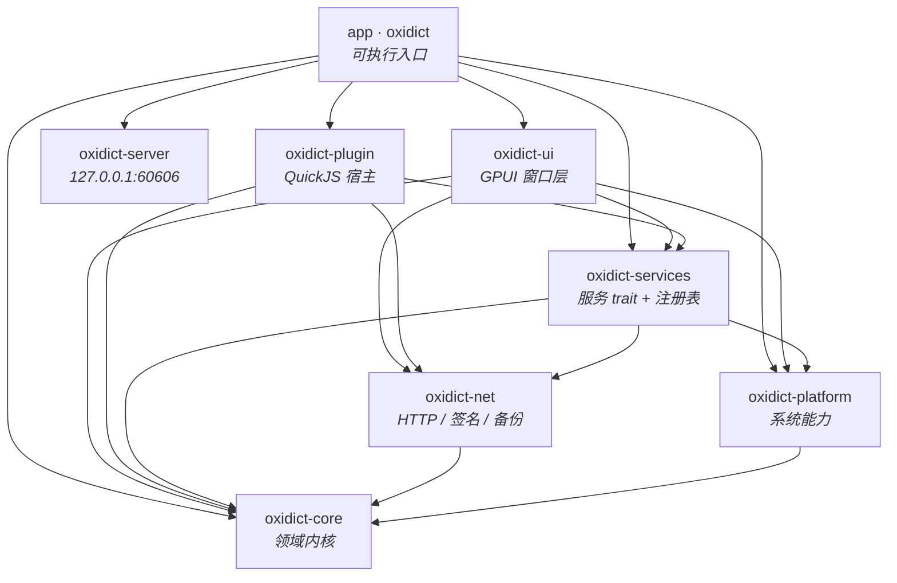
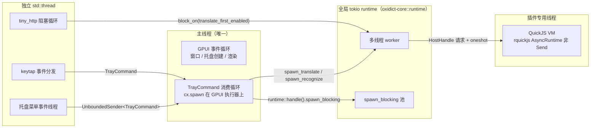
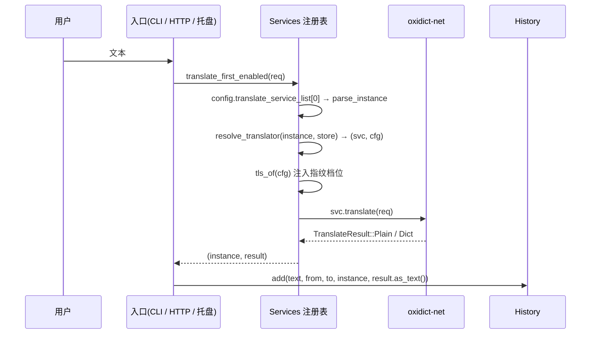
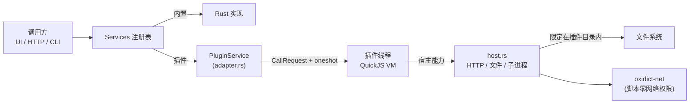

# Oxidict 架构说明

原 [Saladict](https://github.com/crimx/ext-saladict) 桌面端（Tauri 1.6 + React 19，251 个前端文件）
的纯 Rust 重写。本文说明**有哪些包、各自负责什么、依赖方向为什么是这样、一次翻译请求在进程里
怎么流动**。想快速上手改代码，看第 10 节「目录导览」找文件。

- 只想跑起来：看根 [README](../README.md)
- 只想看某个包的细节：看该包目录下的 `README.md`

---

## 1. 项目定位与设计目标

| 目标 | 落地方式 |
| --- | --- |
| 去掉 WebView | 全部 UI 用 gpui-kit 原生绘制，无 HTML/JS 渲染链路 |
| 保留老用户数据 | `config.json` 键名结构、`history.db` 表结构、`.potext` 插件包格式三者与原版一致 |
| 服务可扩展且不牺牲可测性 | 服务抽象为 trait + 注册表，内置服务与 JS 插件对调用方**同构** |
| 单进程单体 | 不做 C/S 拆分；内核（配置/服务/HTTP/插件）与窗口层同进程，靠 crate 边界约束依赖方向 |

**明确的非目标**：不做多进程/远程服务端架构；不为「未来可能的多后端」预埋 `dyn Trait` 抽象层
（见 7.2 备份后端的取舍）。

---

## 2. 分层总览

### 2.1 依赖图

箭头方向 = 「依赖」。这是一张 **DAG，无环**：



### 2.2 各包职责

| 包 | 一句话职责 | 关键内容 | 依赖 |
| --- | --- | --- | --- |
| **oxidict-core** | 与 UI 框架无关的领域内核 | `Language` 统一码表、`ConfigStore`、`History`(sqlite)、领域模型与四类 Request、`ConfigField` 声明式表单、Fluent i18n、`Error`、全局 tokio runtime | 无内部依赖 |
| **oxidict-net** | 网络层：HTTP + 签名 + 备份传输 | wreq 客户端与指纹档位、SSE 流解析、HMAC/MD5/SHA256/AWS SigV4/TC3/阿里云转义、WebDAV、备份后端枚举 | core |
| **oxidict-platform** | 三平台系统能力 | 划词、截图（含交互框选）、系统 OCR、全局快捷键、剪切板监听、光标位置、语言检测、Dock 策略、开机自启、打开路径 | core |
| **oxidict-services** | 服务抽象与全部内置实现 | `Translator`/`Recognizer`/`Tts`/`Collector` 四个 trait、`Services` 注册表、翻译 30 + OCR 15 + TTS 3 + 生词本 2 | core, net, platform |
| **oxidict-plugin** | `.potext` 插件运行时 | rquickjs 宿主线程、`oxidict` 原生模块与 legacy `utils`、插件安装/卸载、脚本 → 服务 trait 适配 | core, services, net |
| **oxidict-server** | 本机外部调用接口 | tiny_http 监听 `127.0.0.1:60606`，路由与原版一致，第三方可用 curl 触发翻译 | core |
| **oxidict-ui** | GPUI 窗口层 | 6 个窗口模块（翻译 / 输入翻译 / 识别 / 设置 / 通知 / 更新）、托盘与命令循环、快捷键录制、排版标尺、品牌资产 | core, services, net, platform |
| **app (`oxidict`)** | 可执行入口 | 启动顺序编排、日志、单实例锁、CLI `--translate`、把各方接起来 | 全部 |

### 2.3 依赖方向规则

这些规则是**有意的约束**，改代码时不要打破：

| 规则 | 为什么 |
| --- | --- |
| `oxidict-core` 不依赖任何内部 crate | 它是叶子。服务层/UI 层都能依赖它，它不能反过来依赖任何人，否则立刻成环 |
| `oxidict-core` / `net` / `platform` / `services` / `plugin` **不依赖 gpui-kit** | 内核必须能脱离窗口独立运行与测试：CLI（`--translate`）、本地 HTTP 服务、插件宿主都不该拉起渲染循环 |
| `oxidict-ui` 不被任何包依赖（只有 `app` 依赖它） | 窗口层是终端消费者，业务逻辑下沉到 services/platform，避免 UI 与逻辑互相纠缠 |
| `oxidict-services` 依赖 `oxidict-platform` 是**受控例外** | `recognize/system`（系统 OCR）、`tesseract` 等内置服务确实要调系统能力；platform 层本身不依赖 services，方向未反 |
| 服务层不直接持有 `ConfigStore` 单例 | 实例配置由调用方（`app` / `ui`）从 store 读出后通过 `*.config` 传入，服务函数保持纯函数式，好测 |

> 历史备注：`gpui-kit` 曾走 git rev `cbdf5baa`（配 `gpui-shell`）。现已统一为 crates.io 的
> `gpui-kit 0.6`，`gpui-shell` 全部移除。

---

## 3. 运行时模型

### 3.1 线程与执行器拓扑

这个项目里同时存在**四套执行上下文**，桥接关系是理解代码的关键：



要点：

- **GPUI 有自己的执行器**，不注入 tokio 上下文。跨执行器的桥是 `JoinHandle`：
  `tokio::JoinHandle` 不依赖 tokio 线程局部，可以在 GPUI 的 future 里直接 `.await`。
  见 `oxidict-core/src/runtime.rs`。
- **阻塞调用一律不能留在 GPUI 主线程**：`selection::selected_text()`（macOS 走 AX）与
  `screenshot::capture_interactive()`（macOS 走 `screencapture -i` 交互框选）都通过
  `spawn_blocking` 甩到 tokio 池。见 `oxidict-ui/src/lib.rs` 的命令循环。
- **托盘与全局快捷键不直接改状态**：它们只发 `TrayCommand`，真正的变更在 GPUI 命令循环里执行，
  保证所有 GUI 状态变更都落在 GPUI 执行器上。`TrayCommand` 故意不写兜底分支——新增变体时
  `match` 会直接编译失败，强迫显式处理。
- **插件 VM 固定在一个专职线程**：rquickjs 默认配置下 `AsyncRuntime` 是 `!Send`，因此
  每个插件一个 VM，全部跑在同一线程，调用方通过 channel 提交、oneshot 回传。

### 3.2 全局单例清单

进程级 `OnceCell`/静态，启动期初始化，之后只读或内部加锁：

| 单例 | 位置 | 初始化时机 |
| --- | --- | --- |
| `STORE: OnceCell<Arc<ConfigStore>>` | `oxidict-core::config` | `ConfigStore::init()`（app 启动第 1 步） |
| `DB: OnceCell<Arc<History>>` | `oxidict-core::history` | `History::init_default()` |
| `SERVICES: OnceCell<Services>` | `oxidict-services` | `init_builtin_services()` |
| tokio runtime | `oxidict-core::runtime` | 首次 `handle()` 惰性创建 |
| Fluent bundle / 当前语言 | `oxidict-core::i18n` | `init_from_config()`，切语言时重建 |
| `TranslateWindowHandle` (GPUI Global) | `oxidict-ui` | 打开翻译窗口时记录弱引用 |

约定：**库代码读「可选」配置时用 `store_opt()`，不要用 `config()`**——后者未初始化会 panic，
只适合「应用入口已保证初始化」的场景。

---

## 4. 核心数据流

### 4.1 翻译：四个入口，一条实现

CLI、本地 HTTP、托盘/快捷键、窗口内的多服务并行，**前三条走同一份服务选择逻辑**
（`translate_first_enabled` / `translate_first_enabled_blocking`），避免三处各写一遍「读列表 →
取首个 → resolve → translate」。



窗口内的翻译是另一条路径：对启用列表里的**每个实例**并发 `spawn_translate`，
各自结果落到一张卡片上（加载 / 结果 / 错误三态）。LLM 类服务通过 `on_stream`
回调把增量文本推回 GPUI，实现流式上屏。

### 4.2 划词翻译

1. 全局快捷键（keytap 观察流）或托盘菜单 → 发 `TrayCommand::SelectionTranslate`
2. GPUI 命令循环 → `spawn_blocking(platform::selection::selected_text)`
3. 取到文本 → `ui::translate_text(text)`：窗口已开则复用，已关则按当前配置重开
4. 翻译窗口对每个启用实例发起翻译

### 4.3 截图 OCR

`TrayCommand::OcrRecognize` → `spawn_blocking(platform::screenshot::capture_interactive)`
→ 非空字节 → `ui::recognize::open_recognize_with_image(cx, bytes)` → 用户点「开始识别」
→ `spawn_recognize(instance, req)` → 结果文本区 + 可选自动复制。

### 4.4 插件服务调用

插件与内置服务在注册表里完全同构，调用方拿到的是 `Arc<dyn Translator>`：



**安全边界**：脚本自身没有网络能力，HTTP 由宿主代发；文件读取与子进程执行都被限制在插件目录内。

### 4.5 配置热更新

`config::watch_config` 监听应用目录，但**只认 `config.json` 自身的事件**：

- 同目录还住着 `logs/`（持续写入）、`history.db`（翻译即写）、`plugins/`、单实例锁文件。
  不过滤就会出现「自己写日志 → 触发 reload → 回调重新应用设置 → 再写日志」的自激循环。
- 过滤规则有专门的回归测试 `only_config_json_triggers_watch_callback`（生产事故防线）。

外部修改（老版本 Tauri 应用在跑、手工编辑）被检测到后：`reload()` 解析失败**返回错误并保持
现有内存数据不变**，绝不把配置清空成默认值。

---

## 5. 落盘布局

```
<config_dir>/net.oxidict.app/          # APP_ID
├── config.json                        # 与原版同结构；原子落盘（写 .tmp 再 rename）
├── history.db                         # sqlite，表结构同原版
├── plugins/                           # 已安装的 .potext（解压后的目录）
└── logs/oxidict.log                   # 托盘「查看日志」打开这里

<runtime_dir 或 cache_dir>/oxidict-app.lock   # 单实例锁（内容为 PID）
```

| 数据 | 兼容性承诺 |
| --- | --- |
| `config.json` | 键名/结构完全对齐；缺失键按默认值补齐且**不会清掉老键**（`apply_defaults` 只 `or_insert`） |
| `history.db` | `history(id, text, source, target, service, result, timestamp)` 与原版逐列一致，老库可直接用 |
| `.potext` | 「zip + `info.json` + `main.js`」，装完不改写，运行时直接 eval 原始 `main.js` |

注意事项：

- **APP_ID 已从 `allen.town.focus.saladict` 改为 `net.oxidict.app`**，老配置需手工拷贝目录。
- 配置解析失败时原文会被改名为 `config.json.corrupt` 留档，再以默认配置启动——不会静默覆盖。
- `save()` 的「取快照 → 写临时文件 → rename」在 `save_lock` 内串行执行。并发 `set` 若各自快照后
  先后 rename，先取的旧快照最后落地会把后写的键整段抹掉。

---

## 6. 平台能力矩阵

| 能力 | macOS | Windows | Linux |
| --- | --- | --- | --- |
| 划词取文本 | `selection` crate（AX） | 剪切板模拟 | 剪切板模拟 |
| 截图 / 区域截图 | `screenshots` | `screenshots` | `screenshots` |
| 交互式框选 | `screencapture -i` | — | — |
| 系统 OCR | 外部命令回退（Vision 接入点已注明） | `windows` crate → `Media.Ocr` | `tesseract` 命令行 |
| 全局快捷键 | keytap（CGEventTap） | keytap（`WH_KEYBOARD_LL`） | keytap（evdev） |
| 光标位置 | `mouse_position` | 同左 | 同左 |
| 剪切板监听 | `arboard` 轮询去抖 | 同左 | 同左 |
| 语言检测 | `lingua` 离线 | 同左 | 同左 |
| Dock 图标隐藏 | `NSApplicationActivationPolicy::Accessory` | no-op | no-op |
| 开机自启 | LaunchAgent plist | 注册表 Run 键 | `.desktop` 文件 |
| 验证状态 | **已编译 + 端到端验证** | 分支就绪，待目标机器验证 | 分支就绪，待目标机器验证 |

两个反直觉的取舍值得记住（详见 `oxidict-platform` README）：

1. **不用 `rdev`**：其键盘 tap 回调在 OS 线程调 HIToolbox 查键盘布局，新版 macOS 上一敲键即
   `dispatch_assert_queue_fail` → SIGILL 闪退。
2. **不用 `global-hotkey`**：macOS/Windows 后端没问题，但 Linux 后端只有 `x11-dl`，
   Wayland 会话下快捷键完全失效。

---

## 7. 关键设计决策

### 7.1 服务层：trait + 注册表，而不是命名空间聚合

原实现是一组 JS 模块靠 `index.jsx` 命名空间聚合。这里改为 `Arc<dyn Translator>` 注册到
`Services`，带来三个直接收益：内置实现与 JS 插件**对调用方不可区分**；`config_schema()`
让设置面板统一渲染表单（30 份手写 `Config.jsx` 归一）；服务可脱离 UI 单测。

### 7.2 备份后端：enum 派发而非 `dyn Trait`

对齐参考实现 clippi 的 `services/backends`（`local_folder` / `webdav` 双后端 + 按类型分派的工厂）。
唯一差异：clippi 的后端集合运行期可增（`Vec<BackendConfig>` + `dyn Trait`），本工程的启用后端由
**单一** `backup_type` 决定、集合封闭，因此用 enum 派发——省掉 boxed future，`match` 还能保证穷尽性。
将来要变多后端并存，再引入 trait 不迟。

### 7.3 中转类翻译服务：一张表 + 一个执行器

改造前 9 个 LLM 中转服务各占一个文件（约 1600 行），实测每个与 `openai_cloud.rs` 只差 23–24 行，
且差异全是文档注释、结构体名、`DEFAULT_MODEL`、`MODELS`、`id()` 与错误串——**真正的差异只有数据**。
现在收敛为 `RELAYS` 静态表 + `Relay` 执行器，新增同类服务只需加一行。

**刻意不做的事**：变换器只提供具名枚举（`BodyShape` / `FieldShape`），不引入通用表达式或脚本语言。
需要任意逻辑（多步请求、签名、解析 HTML）时走 `.potext` 插件，而不是在这里造一门小语言。

### 7.4 自定义服务：声明式 spec，而不是通用编排

「单次请求 + 从 JSON 取字段」的翻译服务不需要写代码，往 `custom_services` 追加一条 spec 即生效。
但**任意编排**（条件、循环、状态机）明确交给 `.potext` 插件：把 spec 做成通用脚本语言，
会让「配错了很难查」取代「配不了」成为主要问题。

不合法 spec **只跳过并在日志里指出下标**，不让应用起不来；与内置服务同名的 spec 会被跳过，
避免悄悄顶掉内置实现。

### 7.5 HTTP 客户端用 wreq 而不是 reqwest

唯一理由是**能模拟浏览器指纹**。服务一旦可配置网页端点，端点集合就是开放的，而这类页面普遍用
WAF 按 TLS（JA3/JA4）与 HTTP/2 特征判定客户端；`wreq` 还能保留 HTTP/1 header 的大小写
（reqwest 会小写化，部分 WAF 因此拒绝）。代价（BoringSSL 原生构建、根证书集不同、硬分叉跟随
上游补丁）与能力边界（它只管 L1/L2，L3 会话、L4 HTML、L5 风控挑战、L6 限速都要另做）见根 README。

缺省或不认识的 `tls` 值一律回退 `native`——宁可指纹不匹配，也不要因一个拼写错误让所有请求
「假装是 Safari」。

### 7.6 UI 与逻辑的分工

服务选择、历史写入、平台调用都在 `services`/`platform`/`app` 里，UI 只做渲染与交互编排。
后果：`cargo test` 能在无窗口环境下覆盖大部分逻辑；CLI 与 HTTP 入口复用同一份实现。

---

## 8. 扩展点

| 想加什么 | 改哪里 | 是否需要写 Rust |
| --- | --- | --- |
| 新的「单请求 + JSON 取字段」翻译服务 | `config.json` 的 `custom_services`，或设置页「自定义服务」 | 否 |
| 新的内置翻译服务 | `crates/oxidict-services/src/translate/<name>.rs` + `translate/mod.rs::register` | 是 |
| 新的 LLM 中转服务 | `translate/relay.rs` 的 `RELAYS` 加一行 | 是（一行） |
| 新的 OCR / TTS / 生词本服务 | 对应 `recognize|tts|collection/` 下新增文件 + `register()` | 是 |
| 任意复杂逻辑的翻译服务 | 做一个 `.potext` 插件 | 否（写 JS） |
| 新的备份落点 | `oxidict-net/src/backup_backend.rs` 加枚举变体 + 分派分支 | 是 |
| 新的设置页 | `oxidict-ui/src/config_window/pages.rs` + `mod.rs` 的 `NAV_ITEMS` | 是 |
| 新的窗口 | `oxidict-ui/src/` 新增模块，参照 `notify.rs`（最薄的一个） | 是 |

**加服务后别忘了**：`config_schema()` 决定设置面板长什么样；`map_language()` 只在厂商语言码与
内部码不一致时才需要覆写。

---

## 9. 构建与验证

| 项 | 值 |
| --- | --- |
| 工具链 | 由 `rust-toolchain.toml` 钉死 **1.98.1**（components: rustfmt, clippy；profile: minimal），rustup 自动安装 |
| Edition / resolver | edition 2024，resolver 2 |
| Lint 基线 | `[workspace.lints]`：`rust_2018_idioms`、`unsafe_op_in_unsafe_fn`、clippy `all`、`undocumented_unsafe_blocks`、`unwrap_used`；各 crate 用 `[lints] workspace = true` 接入 |
| CI | macOS runner：`cargo fmt --all --check` → `cargo clippy --workspace --all-targets --locked -- -D warnings` → `cargo test --workspace --locked` |
| 构建依赖 | BoringSSL 需要有 `cmake` + `perl` + `libclang` + `git`（macOS 装 Xcode CLT 即可） |

Lint 策略上有两条刻意保留的豁免，改动时别误删：

- `elided_lifetimes_in_paths = "allow"`：gpui 的 `Window`/`Context` 签名大量省略生命周期，逐个补是纯噪声。
- `unwrap_used = "warn"` 而非 deny；测试文件内**模块级**豁免（`#![allow(clippy::unwrap_used)]`）。
  `expect` 允许，但 message 必须说明被违反的不变量。

---

## 10. 目录导览

```
app/src/main.rs                     启动编排 + 日志 + 单实例锁 + CLI
crates/
  oxidict-core/
    src/config.rs                   ConfigStore / keys / watch_config
    src/language.rs                 统一语言码枚举 + map_language!
    src/model.rs                    领域模型 + 四类 Request + HasConfig
    src/schema.rs                   ConfigField（声明式表单）
    src/history.rs                  sqlite 历史库
    src/i18n.rs                     Fluent + 20 locale
    src/backup.rs                   打包/解包/导入导出
    src/runtime.rs                  全局 tokio runtime
    src/error.rs                    Error / Result
    locales/<20 种>/main.ftl        翻译文案
  oxidict-net/
    src/http.rs                     wreq 客户端 + 指纹档位 + SSE
    src/sign.rs                     HMAC/MD5/SHA256/AWS/TC3/阿里云
    src/webdav.rs                   WebDAV raw HTTP
    src/backup_backend.rs           备份后端 enum 派发
  oxidict-platform/
    src/{selection,screenshot,ocr,hotkey,clipboard,mouse,detect,dock,autostart,shell}.rs
    src/ocr/{macos,windows,linux}.rs
  oxidict-services/
    src/lib.rs                      trait + 注册表 + 面向 UI 的异步入口
    src/translate/                  30 个翻译服务（21 独立 + 9 表驱动中转）
      relay.rs                      9 个 LLM 中转的声明式表
      custom.rs                     config 驱动的自定义服务（1640 行，最大单文件）
    src/recognize/                  15 个 OCR 服务
    src/tts/                        3 个 TTS 服务
    src/collection/                 2 个生词本服务
  oxidict-plugin/
    src/runtime.rs                  插件线程 + VM 生命周期
    src/host.rs                     oxidict 原生模块 / 全局对象 / legacy utils
    src/adapter.rs                  插件 → 服务 trait 适配
    src/install.rs                  .potext 安装/卸载
  oxidict-server/src/lib.rs         127.0.0.1:60606 路由
  oxidict-ui/
    src/lib.rs                      窗口创建 + 主题 + 命令循环
    src/{translate_window,input_translate,recognize,notify,updater}.rs
    src/config_window/{mod,pages,services}.rs
    src/{tray,hotkey,tokens,logos}.rs
docs/                               本目录
scripts/                            bundle.sh / gen_icons.py / stats.py
```
